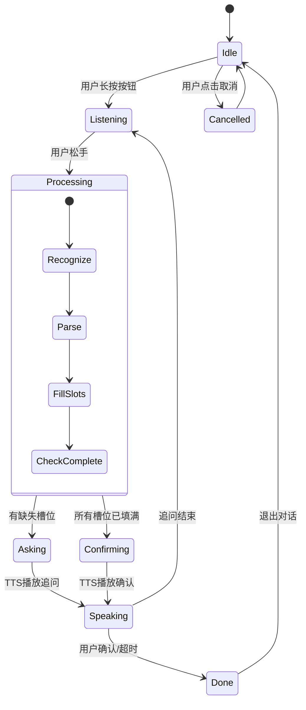
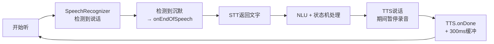

# MY PLAN AI语音助手 — 产品需求文档

**版本**：V1.0 | **日期**：2026-07-14 | **作者**：刘洋 | **状态**：待评审

---

## 一、概述

### 1.1 产品概述及目标

#### 1.1.1 背景

MY PLAN 当前创建计划的路径是：列表页 → FAB → 编辑页 → 填写名称 → 选分类 → 设重复模式 → 添提醒时间（可能多次）→ 保存。对于"每天早上8点和晚上8点学英语"这种常见场景，用户需要至少 5 次点击 + 多次键盘输入。

同时，竞品（Todo清单、滴答清单、Microsoft To Do）均不支持语音创建计划。在微信发语音消息已成习惯的今天，"打字创建提醒"的产品范式已经落后于用户的操作直觉。

**核心机会：** 用语音对话把创建计划的流程从"填表单"变成"说一句话+回答几个问题"，让操作步数从 5+ 次交互降到 1 次说话。

#### 1.1.2 产品概述

AI语音助手是 MY PLAN 的一个全局语音对话功能。用户在 App 内**说"新建计划"即可自动唤醒助手**，无需点击任何按钮。助手激活后通过半双工语音对话收集计划信息（名称、提醒时间、重复模式），填满槽位后自动创建计划。

**交互范式：免提半双工对话。** 类似于和一个人说话——你说一句，助手回复一句，循环直到计划创建完成。全程不需要触碰屏幕。

**三个核心状态：**

```
休眠监听（只检测"新建计划"关键词）
    │
    │  用户说"新建计划"
    ▼
激活对话（助手提问 → 用户回答 → 槽位填充）
    │
    │  全部槽位填满 + 用户确认
    ▼
创建完成（保存计划 → 返回休眠监听）
```

**一句话描述：** 对手机说"新建计划"，然后像聊天一样告诉它你要做什么。30秒完成一个计划，零次点击。

**关键设计决策：**
- **激活词唤醒而非全程发给LLM：** 休眠状态下仅本地检测"新建计划"关键词，不上传任何语音。激活后才开始对话。避免费用浪费和隐私风险。
- **半双工而非全双工：** 助手说话时不录音，用户说话时助手不插话。避免 TTS 被当成用户输入。这是 Half_duplex_speech_recognition_system_agent 验证过的成熟模式。
- **自动退出：** 15秒无人说话自动回到休眠监听。对话框不拦截正常 App 操作。

#### 1.1.3 产品目标

| 维度 | 目标 | 衡量方式 |
|------|------|---------|
| 效率 | 语音创建计划平均耗时 < 30秒 | 从触发到保存的端到端计时 |
| 完成率 | 语音对话完成率 > 80% | 进入对话后成功创建计划的占比 |
| 覆盖 | 手动创建计划的 20% 转为语音创建 | 语音创建数量 / 总创建数量 |
| 体验 | 对话轮次 ≤ 5轮 | 用户输入轮次 + 助手追问轮次 |

#### 1.1.4 目标用户

| 用户类型 | 场景 | 痛点 |
|---------|------|------|
| 通勤上班族 | 地铁/公交上单手操作不便 | 打字费劲，点击不准 |
| 多任务场景 | 做饭/开车/运动时想到要做的事 | 手被占着，无法操作手机 |
| 高频添加者 | 每天新建 3+ 计划的用户 | 重复填表单产生操作疲劳 |
| 老年/低技术用户 | 不熟悉 App 表单操作 | 说话比打字自然 |

### 1.2 名词说明

| 术语 | 说明 |
|------|------|
| 激活词 (Wake Word) | 唤醒语音助手的特定短语。当前仅支持"新建计划" |
| 休眠模式 (Dormant Mode) | 仅监听激活词的省电状态。不上传语音，不做识别 |
| 半双工对话 (Half-Duplex) | 轮流发言模式：用户说 → 助手处理+回复 → 继续听用户说。同一时刻只有一方在说话 |
| 槽位 (Slot) | 计划的一个属性字段：名称、分类、提醒时间、重复模式 |
| 槽位填充 (Slot Filling) | 从用户自然语言中提取槽位值的过程 |
| NLU | 自然语言理解。V1 使用规则引擎，不依赖云端 LLM；V1.5 DeepSeek Function Calling |
| 确认回显 | 助手在用语音追问前，先用一句话确认已理解的信息 |
| 静默超时退出 | 连续 15 秒无用户语音输入 → 助手自动退出对话 → 回到休眠监听 |

### 1.3 角色及权限

| 角色 | 权限 |
|------|------|
| 所有用户 | 可使用语音助手创建计划（无需登录或会员） |

### 1.4 文档阅读对象

产品、开发（Android/Kotlin）、测试

---

## 二、产品描述

### 2.1 产品需求描述

用户在 MY PLAN App 内任意页面（列表页/日历页/统计页）说"**新建计划**"，AI 语音助手被自动唤醒。助手通过半双工语音对话收集计划信息——它提问，用户回答——填满所有槽位后自动创建计划并保存到数据库。

**核心体验：** 用户从"填表单"变成"聊天"。不需要找按钮、不需要打字、不需要盯着屏幕。就像对身边的人说"帮我记一下，明天开始每天早晚提醒我吃药"一样自然。

**V1 范围：**
- ✅ 仅支持**创建**新计划，不支持修改已有计划
- ✅ 仅支持一个激活词："新建计划"
- ✅ 创建完成后自动退出对话，回到休眠监听
- ❌ 不支持在对话中查看/编辑/删除已有计划
- ❌ 不支持非创建类的语音指令（"我今天有哪些计划"）

**NLU 架构：双引擎。** 休眠状态下纯本地关键词检测（不上传任何语音）。激活后的对话理解——V1 使用本地规则引擎（离线、零延迟），V1.5 引入 DeepSeek Function Calling（在线增强）。

### 2.2 产品整体流程

#### 激活词唤醒 + 对话主流程

```mermaid
flowchart TD
    A[🔵 休眠监听状态<br/>仅检测激活词] --> B{用户说<br/>"新建计划"?}
    B -->|否| A
    B -->|是| C[🔊 播放激活提示音<br/>进入对话模式]

    C --> D[🤖 助手语音：<br/>"你好，想创建什么计划？"]
    D --> E[👤 用户自然说话]
    E --> F{用户说了什么?}

    F -->|"取消"/"算了"| G[🔵 回到休眠监听]
    F -->|正常描述计划| H[NLU解析<br/>提取已识别槽位]

    H --> I{所有必填槽位<br/>已填满?}

    I -->|否| J[确认回显已识别信息<br/>+ 追问下一缺失槽位]
    J --> E

    I -->|是| K[🤖 助手确认：<br/>回显所有字段<br/>+ "确认创建吗？"]
    K --> L{用户回复}
    L -->|"确认"/"好的"/"行"| M[✅ 保存计划<br/>调度闹钟]
    L -->|"不对"/"改一下"| E
    L -->|5秒未响应| M

    M --> N[🔊 "已创建"<br/>回到休眠监听]

    E -->|15秒无人说话| O[🔊 "有需要再叫我"<br/>回到休眠监听]
```

#### 完整对话示例

```
[列表页]  用户："新建计划"
          🔊 叮～
          🤖："你好，想创建什么计划？"

          用户："每天提醒我吃药"
          🤖："好的，吃药。几点提醒你？"

          用户："早上8点、中午12点、晚上8点"
          🤖："早中晚三次。工作日还是每天？"

          用户："每天"
          🤖："好的——「吃药」学习，每天早8点、中12点、晚8点提醒你。确认创建吗？"

          用户："确认"
          🔊 叮～
          🤖："已创建。有需要再叫我。"
          [回到休眠监听]

[列表页]  计划「吃药」已出现在列表中 ✅
```

#### 槽位填充状态机



#### 对话示例

```
👤 [长按] "帮我制定一个学习英语的计划，每天早上8点提醒我"
🤖 "好的，每天早上8点学英语。工作日还是每天？"
👤 [长按] "工作日"
🤖 "工作日。什么类型呢？"
👤 [长按] "学习"
🤖 "「学英语」学习计划已创建，工作日早上8点提醒你。"
```

### 2.3 全局说明

#### 异常处理

| 异常场景 | 处理方式 |
|---------|---------|
| 语音识别为空 | 助手："抱歉，我没听清，能再说一遍吗？" |
| 语音识别置信度低 | 助手回显识别结果 + "是这个意思吗？" |
| 用户长时间未说话（10秒） | 助手："还在吗？需要帮助就说，不需要就点取消。" |
| 连续3次识别失败 | 助手："可能环境有点吵。需要切换成手动填写吗？" → 弹出表单 |
| 用户说"取消"/"算了" | 立即退出对话模式，已填信息保留在编辑页（不丢失） |
| 用户说"换一个"/"不是这个" | 清除上一个槽位值，重新追问该字段 |
| TTS引擎不可用 | 降级为文字气泡展示追问内容（不播放语音） |
| 语音识别不可用 | 降级为文字输入模式（键盘打字代替说话），助手仍语音回复 |
| 后台来电/闹钟打断 | 保存当前对话状态，保持编辑页预填内容不丢失 |

#### 重复模式默认值

当用户未明确说"工作日"或"周末"或"周一三五"时，**默认使用"每天"**。如果用户在后续对话中补充了重复信息，覆盖默认值。

#### 分类默认值

当用户未指定分类时，助手**不追问分类**（非必填槽位），默认使用"日常"。这样避免不必要的对话轮次。

### 2.4 产品版本规划

| 版本 | 范围 | 上线条件 |
|------|------|---------|
| V1.0 | 语音创建计划（规则引擎 NLU） | 离线可用、5轮内完成、80%完成率 |
| V1.5 | DeepSeek Function Calling 在线增强 | 双引擎切换、自然表达、复杂时间（"每隔一天"等） |
| V2.0 | 纠错/修改已创建槽位（"改成晚上7点吧"） | V1.5 数据达标 |
| V2.5 | 对话历史 + 多计划管理（"看看我明天的计划"） | 用户基数 > 1000 |

### 2.5 产品框架

语音助手以**全局服务**的形式存在，不绑定特定页面。

```
MyPlanApp (Application)
├── VoiceAssistantService（前台服务，保活）
│   ├── WakeWordDetector（休眠模式：仅检测"新建计划"）
│   ├── SpeechRecognizerWrapper（激活后：完整 STT）
│   ├── TextToSpeechWrapper（TTS 播报 + UtteranceProgressListener）
│   ├── ConversationManager（状态机 + 槽位管理）
│   ├── SlotFiller（NLU 规则引擎）
│   └── VoiceApiService（DeepSeek API · V1.5）
│
├── UI 层
│   ├── VoiceIndicator（顶部/悬浮胶囊：状态显示）
│   │   ├── 休眠：灰色圆点 + 🔊 图标
│   │   ├── 激活：绿色脉冲 + 当前槽位进度
│   │   └── 错误：红色 + 提示文字
│   └── VoiceDebugOverlay（开发期间：显示识别文字 + 槽位状态）
│
└── 现有架构（不变）
    ├── PlanEditViewModel.save() ← 语音创建的保存入口
    ├── PlanRepository.savePlanWithReminders()
    └── AlarmScheduler.scheduleAlarm()
```

### 2.6 功能清单

| 编号 | 功能 | 优先级 | 说明 |
|------|------|--------|------|
| F0 | 激活词检测 | P0 | 休眠状态下持续监听"新建计划"关键词。纯本地，不上传 |
| F1 | 半双工语音对话 | P0 | 激活后轮流发言：听用户说 → 处理 → TTS 回复 → 继续听 |
| F2 | 槽位提取 | P0 | 从自然语言中解析计划名称、时间、重复模式 |
| F3 | 多轮对话管理 | P0 | 状态机驱动确认回显 + 追问 + 确认 + 创建 |
| F4 | DeepSeek API 增强 | P1 | 联网时替代规则引擎处理复杂表达 |
| F5 | 静默超时退出 | P1 | 15秒无语音输入 → 自动退出对话 → 回到休眠 |
| F6 | 激活词误触防护 | P1 | 检测到"新建计划"但非用户想创建 → 用户说"取消"退出 |
| F7 | 语音对话中断处理 | P1 | 来电/通知打断 → 保存当前槽位 → 恢复后继续 |
| F8 | 对话历史气泡 | P2 | 文字版对话记录（辅助理解） |
| F9 | 音量自适应 | P2 | 噪音环境下自动提高 TTS 音量 |

---

## 三、功能需求

### 3.1 F0：激活词检测（Wake Word）

#### 用户故事
作为用户，我希望在 App 内直接说"新建计划"就能唤醒语音助手，不需要先找到某个按钮再点击。

#### 前置条件
- App 在前台运行
- 录音权限已授权
- 语音助手功能已在设置中开启

#### 后置条件
- 激活词被检测到 → 播放提示音 → 进入半双工对话模式
- 未检测到激活词 → 继续休眠监听

#### 唤醒逻辑

```
休眠监听循环：
    持续录音（低功耗，16kHz mono）
        → 传给激活词检测器（本地，不上传）
        → 检测到"新建计划"？
            → 否：丢弃音频，继续循环
            → 是：播放 🔊 提示音 → 进入 F1 对话模式
```

#### 激活词定义

| 激活词 | 变体（也接受） | 不激活 |
|--------|-------------|--------|
| "新建计划" | "新建一个计划"、"创建一个计划"、"加个计划" | "看计划"、"删除计划"、"新建"（单独一个词不触发） |

#### 激活词检测方案

**V1 使用 Android SpeechRecognizer 的 onPartialResults：**

```kotlin
// 休眠模式下持续低功耗监听
speechRecognizer.startListening(intent)  // EXTRA_PARTIAL_RESULTS = true

// 每次部分结果回调时检查是否包含激活词
onPartialResults { results ->
    if (results.any { it.contains("新建计划") || it.contains("创建") && it.contains("计划") }) {
        playActivationSound()
        enterConversationMode()
    }
}
```

**为什么不引入独立 VAD 模型？** V1 用 Android 原生 STT 的 partial results 就够了——在休眠状态下 SpeechRecognizer 不需要联网（Google 离线语音模型已覆盖中文常见词）。延迟约 500ms，比引入 2MB Silero VAD 模型更简单。

#### 误触防护

| 场景 | 处理 |
|------|------|
| 用户说了"新建计划"但不是想创建 | 对话模式中用户说"取消"/"没事"/"不是" → 立即退出 |
| 环境噪音被误识别 | 连续 3 次激活后用户都说"取消" → 助手静默 30 秒 |
| 用户在和别人说话 | App 退到后台 → 立即停止监听 |

### 3.2 F1：半双工语音对话

#### 用户故事
作为用户，我希望和助手像聊天一样轮流说话——它问我答、我说完它自动处理——全程不需要触碰按钮。

#### 半双工循环



**每次循环的详细步骤：**

1. `startListening()` → 等待用户说话
2. `onEndOfSpeech` 回调 → 用户说完了
3. `onResults(text)` → 拿到文字
4. 暂停 STT（`stopListening`）
5. NLU 解析 → 状态机更新槽位
6. TTS 播放回复（`speak()`）
7. `UtteranceProgressListener.onDone` → TTS 播完了
8. 等待 300ms（echo bleed 缓冲——防止 TTS 尾音被当成用户说话）
9. `startListening()` → 回到第 1 步

#### TTS 播放期间的语音屏蔽

```
TTS 开始播 ────────────────── TTS 播完 ──── 300ms 缓冲 ──── 开始听
                                ↑                          ↑
                     onDone 回调触发               startListening()
```

**为什么需要 300ms 缓冲？** 参考 ai-assistant-android 的 echo bleed filter。TTS 播放结束后声波可能还在房间回荡——如果不加缓冲，第一个音节可能被 SpeechRecognizer 当成用户说话，导致"助手听到了自己说的话"。

#### 退出条件

| 触发条件 | 行为 |
|---------|------|
| 用户说"取消"/"算了"/"不用了"/"退出" | 立即退出 → 休眠监听 |
| 连续 15 秒无用户说话 | 🔊 "有需要再叫我" → 休眠监听 |
| 计划创建完成 | 🔊 "已创建" → 休眠监听 |
| App 退到后台 | 暂停对话 → 保留当前槽位 → 回到前台后恢复 |

#### 前置条件
- 已通过 F0 激活词检测进入对话模式
- 系统语音识别服务可用
- 录音权限已授权

#### 后置条件
- 对话退出 → 回到 F0 休眠监听
- 或计划创建完成 → 数据库更新 → 回到 F0

#### 异常流程
- **权限未授权：** 点击按钮时弹系统权限请求对话框。拒绝后显示"需要录音权限才能使用语音助手"
- **识别服务不可用：** 降级为文字输入模式（键盘输入替代语音），助手仍语音回复
- **识别结果为空字符串：** 同"没听清"处理
- **识别置信度 < 0.5：** 文字回显 + "是这个意思吗？"

### 3.2 F2：语音输出

#### 用户故事
作为用户，我希望助手用语音回复我，而不是让我看屏幕上的文字，以便我能一边做其他事一边创建计划。

#### 前置条件
- 系统 TTS 引擎可用（Android TextToSpeech）
- 输出文本已生成（由对话状态机提供）

#### 界面及交互

| 元素 | 说明 |
|------|------|
| 播放状态 | 助手说话时，顶部状态栏闪烁绿色指示灯 + "正在回复..." |
| 音量 | 使用 Android STREAM_NOTIFICATION 音频流，受系统音量控制 |
| 打断 | 助手说话过程中，用户长按按钮可打断（停止 TTS 并开始收音） |

#### 异常流程
- **TTS不可用：** 降级为对话气泡展示文字（用户仍可看到追问），不播放语音。气泡旁标注"🔇 语音不可用"
- **TTS 语言不匹配：** 检查当前系统 TTS 语言，如果不支持中文则降级为文字

### 3.3 F3：槽位提取（NLU规则引擎）

#### 用户故事
作为用户，我希望说出"每天早上8点和晚上8点学英语"后，助手能自动理解时间、计划和重复模式，不需要我逐项填写。

#### 槽位定义

| 槽位 | 必填 | 类型 | 示例值 |
|------|------|------|--------|
| plan_name | ✅ | String | "学英语"、"吃维生素"、"健身" |
| reminder_times | ✅ | List\<String\> | ["08:00"]、["08:00","20:00"] |
| repeat_mode | ✅ | Enum | "每天"、"工作日"、"自定义(1,3,5)" |
| category | ❌ | Enum | "日常"(默认)、"学习"、"工作"、"健康"、"紧急"、"其他" |

#### 规则引擎设计（V1）

不接云端 LLM。使用关键词匹配 + 正则表达式。解析顺序：

**步骤1：时间提取**
提取所有时间表达，合并为 reminder_times 列表。

| 输入 | 识别为 | 规则 |
|------|--------|------|
| "早上8点" | 08:00 | 早上 + 数字 + 点 |
| "晚上8点" | 20:00 | 晚上 + 数字 + 点 |
| "8点" | 08:00 | 无时间段修饰 → 默认早上 |
| "早上8点和晚上8点" | [08:00, 20:00] | "和"/"还有"/"以及" 分隔多时间 |
| "8点半" | 08:30 | 半 → :30 |
| "下午3点15" | 15:15 | 分钟支持 |
| "每两小时" | ❌ 不识 | V2 支持 |

**步骤2：计划名称提取**
从输入中移除已识别的时间、重复、分类关键词后，剩余部分作为计划名称。

| 输入 | 移除 | 剩余 → plan_name |
|------|------|------------------|
| "每天早上8点学英语" | 每天 + 早上8点 | "学英语" |
| "提醒我吃维生素" | 触发词"提醒我" | "吃维生素" |
| "制定一个学习英语的计划" | 触发词"制定"+"的"+"计划" | "学习英语" |

触发词列表（需要移除的噪声词）：
"提醒我"、"帮我"、"制定"/"创建"/"加一个"、"的计划"/"计划"、"一下"

**步骤3：重复模式提取**

| 输入 | 识别为 |
|------|--------|
| "每天"/"天天"/"每一天" | REPEAT_DAILY |
| "工作日"/"周一到周五"/"上班日" | REPEAT_WEEKDAY |
| "周一三五"/"星期一三五"/"135" | REPEAT_CUSTOM(1,3,5) |
| "周末" | REPEAT_CUSTOM(6,7) |
| 无匹配 | REPEAT_DAILY（默认值） |

**步骤4：分类提取**

| 输入 | 识别为 |
|------|--------|
| "学习"/"英语"/"看书"/"课程" | CATEGORY_STUDY |
| "工作"/"开会"/"项目" | CATEGORY_WORK |
| "健身"/"运动"/"跑步"/"吃药"/"喝水" | CATEGORY_HEALTH |
| "紧急"/"重要" | CATEGORY_URGENT |
| 无匹配 | CATEGORY_DAILY（默认值，不追问） |

#### 异常流程
- **无任何可识别槽位：** 助手："我没太理解，能换个说法试试吗？比如'每天早上8点学英语'。"
- **只识别到部分槽位：** 正常流程，追问缺失槽位

#### DeepSeek API 增强（V2 在线增强）

当设备联网时，V2 使用 **DeepSeek API（Function Calling）** 替代规则引擎做槽位提取，精度更高、支持复杂表达。

##### 为什么选 DeepSeek

| 对比维度 | DeepSeek | 其他选项 |
|---------|---------|---------|
| 现有资源 | ✅ 已有 API Key（`sk-78e...`） | — |
| 中文 NLU 能力 | ⭐⭐⭐⭐⭐ 国内第一梯队 | — |
| Function Calling | ✅ 原生支持结构化 JSON 输出 | — |
| 费用 | ¥1 / 百万 token | 单次对话约 ¥0.002 |
| 延迟 | ~1-2秒 | 千问 ~1秒 / GPT ~2秒 |

##### 架构：双引擎切换

```
用户语音输入
    ↓
规则引擎（本地，< 10ms）
    ↓
置信度 ≥ 0.8？ ──是──→ 直接使用本地结果
    ↓ 否
网络可用？ ──否──→ 用本地结果 + 追问兜底
    ↓ 是
调用 DeepSeek Function Calling
    ↓
返回结构化 JSON → 填入槽位
```

**切换逻辑：**
- 规则引擎始终优先执行（零延迟、离线可用）
- 规则引擎置信度 < 0.8 且网络可用时，自动升级到 DeepSeek
- 用户感知不到切换——只有一个"正在理解..."的状态指示器
- DeepSeek 超时（3秒）或网络错误时，降级为规则引擎结果

##### Function Calling 定义

```json
{
  "model": "deepseek-chat",
  "messages": [
    {
      "role": "system",
      "content": "你是 MY PLAN 的语音助手。从用户输入中提取计划信息，输出结构化 JSON。\n\n规则：\n- plan_name: 计划名称，去除\"帮我\"\"提醒我\"等噪声词\n- reminder_times: 所有提醒时间，24小时制 HH:MM 格式\n- repeat_mode: EVERY_DAY / WEEKDAYS / CUSTOM\n- custom_days: 仅当 repeat_mode=CUSTOM 时，返回星期数字列表 (1=周一~7=周日)\n- category: DAILY / WORK / STUDY / HEALTH / URGENT / OTHER\n- 无法确定时用 null"
    },
    {
      "role": "user",
      "content": "帮我制定一个学习英语的计划，每天早8点和晚8点提醒"
    }
  ],
  "tools": [{
    "type": "function",
    "function": {
      "name": "create_plan",
      "description": "提取用户语音中的计划创建信息",
      "parameters": {
        "type": "object",
        "properties": {
          "plan_name": { "type": "string", "description": "计划名称" },
          "reminder_times": {
            "type": "array", "items": { "type": "string" },
            "description": "提醒时间列表，HH:MM 格式"
          },
          "repeat_mode": {
            "type": "string",
            "enum": ["EVERY_DAY", "WEEKDAYS", "CUSTOM"]
          },
          "custom_days": {
            "type": "array", "items": { "type": "integer", "minimum": 1, "maximum": 7 }
          },
          "category": {
            "type": "string",
            "enum": ["DAILY", "WORK", "STUDY", "HEALTH", "URGENT", "OTHER"]
          }
        },
        "required": ["plan_name", "reminder_times", "repeat_mode"]
      }
    }
  }]
}
```

##### API 调用封装

```kotlin
// VoiceApiService.kt — V2新增文件
object VoiceApiService {
    private const val BASE_URL = "https://api.deepseek.com/v1/"
    private const val API_KEY = BuildConfig.DEEPSEEK_API_KEY

    suspend fun extractSlots(userInput: String): SlotResult {
        val request = buildRequest(userInput) // 构建上方的 JSON
        val response = httpClient.post("${BASE_URL}chat/completions") {
            contentType(ContentType.Application.Json)
            header("Authorization", "Bearer $API_KEY")
            setBody(request)
        }
        return parseFunctionCall(response) // 解析 tool_calls → SlotResult
    }
}

data class SlotResult(
    val planName: String?,
    val reminderTimes: List<String>?,
    val repeatMode: String?,
    val customDays: List<Int>?,
    val category: String?,
    val confidence: Float  // API 返回即视为高置信度
)
```

##### 容错与降级

| 场景 | 处理 |
|------|------|
| API 超时（>3秒） | 静默降级为规则引擎结果 |
| API 返回 4xx/5xx | 降级 + 不上报（避免用户感知焦虑） |
| API 返回 JSON 解析失败 | 降级 + 记录日志便于排查 |
| 网络不可用 | 不尝试调用，直接用规则引擎 |
| 用户关闭"在线增强"设置 | 跳过 API，仅规则引擎 |

##### 费用估算

| 场景 | Token 消耗 | 费用 |
|------|-----------|------|
| 单次槽位提取 | ~500 input + ~200 output = 700 tokens | ¥0.0014 |
| 两轮对话（含追问） | ~1400 tokens | ¥0.0028 |
| DAU 100，人均1次/天 | ~70K tokens/天 | ¥0.14/天 |
| 月均（DAU 100） | ~2.1M tokens/月 | **¥4.2/月** |

**结论：** 即使 DAU 达到 100，月费不到 5 块。产品可用性收益远大于成本。

##### Prompt 注入防护

```kotlin
// 用户输入预处理
fun sanitizeUserInput(input: String): String {
    // 1. 移除可能覆盖 system prompt 的指令模式
    // 2. 截断超过 500 字符的输入
    // 3. 检测"忽略上述指令""你是"等越狱关键词 → 降级为规则引擎
    return input.trim().take(500)
}
```

### 3.4 F4：多轮对话状态机

#### 用户故事
作为用户，我希望和助手的对话像和人说话一样自然，助手记住我说过的内容，只问还没说的信息。

#### 对话状态定义

```kotlin
sealed class ConversationState {
    object Idle : ConversationState()
    object Listening : ConversationState()
    object Processing : ConversationState()
    data class Asking(
        val missingSlots: List<Slot>,
        val filledSlots: Map<Slot, String>,
        val askCount: Int  // 同一槽位追问次数，超过3次换说法
    ) : ConversationState()
    data class Confirming(
        val slots: PlanData
    ) : ConversationState()
    object Done : ConversationState()
    object Cancelled : ConversationState()
}

enum class Slot { PLAN_NAME, REMINDER_TIMES, REPEAT_MODE }
```

#### 追问优先级

槽位不是随机追问的。按以下顺序：

1. **plan_name**（还没说"学什么"就先问这个）
2. **reminder_times**（说了学什么就问几点）
3. **repeat_mode**（说了几点就问重复方式）

**追问文案池（每次随机选一条，避免机械感）：**

| 槽位 | 追问文案（3条随机） |
|------|-------------------|
| plan_name | "想学什么呢？" / "具体是什么计划？" / "要提醒你做什么？" |
| reminder_times | "几点提醒你？" / "什么时间？" / "你想几点收到提醒？" |
| repeat_mode | "工作日还是每天？" / "每天都提醒还是只在工作日？" / "是每天重复还是只在周一到周五？" |

**确认回显模板：**
```
"好的，{确认已识别信息}。{追问缺失信息}"
```

示例：
- 已识别 plan_name="学英语" → "好的，学英语。几点提醒你呢？"
- 已识别 plan_name+times → "好的，早8点和晚8点学英语。工作日还是每天？"

#### 异常流程
- **同一槽位追问3次仍未识别：** 助手："可能我说得不太清楚。你可以直接告诉我{槽位描述}，比如'每天'或者'工作日'。" → 降低追问难度，给出示例
- **用户输入"算了"/"不做了"：** → Cancelled 状态，保存已有槽位到编辑页表单（不丢失）

### 3.5 F5：确认与创建

#### 确认模板
```
"好的——{计划名称}，{重复模式描述}，{提醒时间列表描述}提醒你。确认创建吗？"
```

示例：
- "好的——学英语，工作日，早上8点和晚上8点提醒你。确认创建吗？"

#### 用户确认词（规则匹配）
| 用户回复 | 动作 |
|---------|------|
| "好的"/"行"/"可以"/"确认"/"是的"/"对"/"嗯" | 创建计划 |
| "不对"/"不是"/"改"/"等一下" | 回到 Listening 状态 |
| 5秒内无回复 | 默认创建（沉默=同意） |

#### 后置条件
计划创建成功后：
1. 数据写入 Room 数据库（复用现有 savePlanWithReminders）
2. AlarmScheduler 调度闹钟（复用现有逻辑）
3. 编辑页表单自动填充（用户可看到创建结果）
4. 助手语音播报："已创建"
5. 退出对话模式，返回编辑页

---

## 四、非功能需求

### 4.1 性能需求

| 指标 | 要求 |
|------|------|
| 语音识别延迟 | < 2秒（从松手到返回文字） |
| TTS 播放延迟 | < 500ms（从生成文本到开始播放） |
| NLU 解析耗时 | < 100ms（纯本地规则匹配） |
| 端到端创建耗时 | < 30秒（从触发到计划保存） |
| 内存增量 | < 20MB（语音对话 Overlay + STT/TTS 引擎） |

### 4.2 离线要求

V1 必须 100% 离线可用：
- SpeechRecognizer：使用 Android 系统内置离线语音包（需在设置页引导用户下载中文离线包）
- TextToSpeech：使用 Android 系统内置 TTS 引擎
- NLU：纯本地规则引擎，零网络请求
- **不调用任何云端 LLM API**

### 4.3 安全与隐私

- 语音数据**不上传服务器**。所有识别在设备本地完成。
- 对话文本不持久化存储（退出对话后仅保留创建的计划数据，对话历史丢弃）。
- 录音权限使用 Android 标准运行时权限请求，需在 Manifest 声明 `RECORD_AUDIO`。

### 4.4 统计需求（可后续补充）

| 埋点事件 | 触发时机 | 属性 |
|---------|---------|------|
| voice_start | 用户打开语音助手 | source（编辑页新建/编辑页编辑） |
| voice_speak | 用户说完一句话 | round_number, duration_ms |
| voice_slot_filled | 一个槽位被填满 | slot_name, source（user_said / default） |
| voice_confirm | 用户确认创建 | total_rounds, total_duration_ms |
| voice_cancel | 用户取消 | cancel_reason（user_said / button_click）, rounds_completed |
| voice_error | 任何异常 | error_type, round_number |

---

## 五、附录

### 5.1 验收标准

| # | 验收条件 | 验证方式 |
|---|---------|---------|
| 1 | 用户在列表页/日历页/统计页说"新建计划" → 🔊 提示音 → 助手激活 → TTS："想创建什么计划？" | 手动测试 |
| 2 | 助手激活后，用户正常说话 → 助手自动检测到说完 → NLU 解析 → TTS 回复追问。全程不需要按钮 | 手动测试 |
| 3 | 助手说话时用户说话 → 不会被误识别（300ms echo bleed 生效） | 手动测试 |
| 4 | 完整对话流程：激活 → 提问 → 回答 ×3 → 确认 → 计划保存到列表 | 端到端测试 |
| 5 | 用户说"取消" → 立即退出对话 → 回到休眠监听 | 手动测试 |
| 6 | 连续 15 秒无人说话 → 助手自动退出 → 回到休眠监听 | 计时测试 |
| 7 | 创建完成后自动回到休眠监听，可再次用"新建计划"激活 | 循环测试 ×3 |
| 8 | App 退到后台 → 立即停止录音（不偷听） | 手动测试 |
| 9 | 关掉 WiFi → 规则引擎仍可用 → 离线创建正常完成 | 手动测试 |
| 10 | 无权限时提示"需要录音权限才能使用语音助手" | 手动测试 |

### 5.2 技术建议

**新增文件（预估）：**
```
app/src/main/java/com/mx/plan/
├── voice/
│   ├── VoiceConversationManager.kt   // 对话状态机
│   ├── SlotFiller.kt                 // NLU规则引擎（本地）
│   ├── VoiceApiService.kt            // DeepSeek Function Calling（V1.5）
│   ├── SpeechRecognizerWrapper.kt    // STT封装
│   ├── TextToSpeechWrapper.kt        // TTS封装
│   └── VoiceDialogScreen.kt          // Compose UI Overlay
```

**修改文件：**
```
PlanEditScreen.kt          // 添加麦克风按钮入口
PlanEditViewModel.kt       // 对接待语音创建的保存流程
AndroidManifest.xml        // RECORD_AUDIO 权限声明
```

### 5.3 待确认项

1. **[待确认]** Walkie-talkie 模式（长按说话）是唯一交互方式，还是也支持"唤醒词"激活？
2. **[待确认]** V1 是否只做"新建"，还是也支持"编辑已有计划"？
3. **[建议]** 分类默认值是否需要让用户可修改（在设置页增加"默认分类"选项）？
4. **[可选]** 是否需要对话历史气泡 UI，还是仅语音交互？

### 5.4 参考

- Android SpeechRecognizer 文档：https://developer.android.com/reference/android/speech/SpeechRecognizer
- Android TextToSpeech 文档：https://developer.android.com/reference/android/speech/tts/TextToSpeech
- 现有产品编辑流程：`PlanEditScreen.kt` + `PlanEditViewModel.kt`
- 现有数据模型：`Plan.kt` (Room Entity) + `Reminder.kt`
