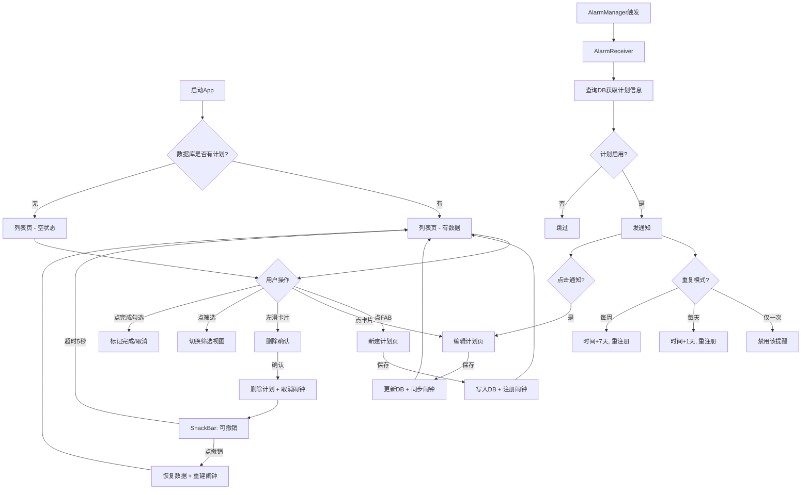

# MY PLAN — 产品需求文档

> 版本：v0.1 | 日期：2026-06-13 | 作者：MQTQW + Claude Code

---

## 一、概述

### 1.1 产品概述及目标

#### 1.1.1 背景介绍

市面上虽有不少计划管理 App，但普遍存在三个问题：
- **操作太重**：需要填大量字段、选标签、设优先级，用起来像工作软件而非个人工具
- **视觉冰冷**：白底黑字的任务清单，缺乏情感温度
- **提醒方式单一**：只支持单次提醒或固定周期，无法灵活组合

MY PLAN 要做一个**有温度的个人计划提醒应用**——操作轻量、视觉温馨、提醒灵活。

#### 1.1.2 产品概述

MY PLAN 是一款 Kotlin Native Android 计划提醒应用。用户可以：
- 快速创建分类计划（日常/紧急/工作/学习/健康/其他）
- 为每个计划设置**多个**提醒时间，每个提醒**独立控制**重复模式
- 到时间通过系统通知栏提醒
- 标记完成、按状态筛选

设计语言为「活泼可爱风」——珊瑚橙强调色、三色便签卡片、Emoji 装饰、时间段问候语。

#### 1.1.3 产品目标

| 维度 | 目标 | 衡量标准 |
|------|------|---------|
| 功能 | v1.0 覆盖个人计划全流程 | 22 项核心功能可用 |
| 体验 | 从打开到创建首条计划 < 30 秒 | 新用户引导 + 空状态 |
| 稳定性 | 不丢数据、不漏提醒 | 零 P0 崩溃缺陷 |
| 一致性 | UI 与 Pencil 设计稿偏差 < 5% | 视觉走查清单 |

#### 1.1.4 目标用户

**主要用户**：有个人目标/习惯管理需求的普通用户，非企业场景。
- 想要简单计划工具，不想用 Notion / Trello 等重型工具
- 对视觉有要求，不喜欢"办公软件"风格
- 需要多时段提醒（如每天早晚各一次 + 周五下午特别提醒）

### 1.2 名词说明

| 术语 | 说明 |
|------|------|
| 计划 (Plan) | 用户创建的一条目标/任务，包含名称、描述、分类 |
| 提醒 (Reminder) | 计划的子项，包含时间、重复模式、启用状态。一个计划可有多个提醒 |
| 重复模式 | 仅一次 (NONE) / 每天 (DAILY) / 每周 (WEEKLY) |
| 分类 | 6 个预设：日常/紧急/工作/学习/健康/其他 |
| 筛选 | 全部/进行中/已完成的计划过滤 |

### 1.3 角色及权限

| 角色 | 权限 |
|------|------|
| 用户（唯一角色） | 全部：CRUD 计划、设提醒、筛选取、标记完成 |

单用户应用，无多角色权限体系。

---

## 二、产品描述

### 2.1 产品需求描述

一个运行在 Android 10+ 手机上的原生 App，支持离线使用。核心能力：

1. **计划管理**：增删改查、分类、完成标记
2. **提醒管理**：多提醒时间、独立开关、重复模式
3. **提醒通知**：到时间系统通知栏弹出
4. **开机恢复**：重启后自动重新注册闹钟

### 2.2 产品整体流程



### 2.3 全局说明

#### 异常处理
| 场景 | 处理 |
|------|------|
| 计划名称为空 | 保存时校验，红色边框 + "请输入计划名称" |
| 未保存修改返回 | 弹窗 "有未保存的更改，确定放弃吗？" |
| 提醒时间已过 | 不阻止创建，但触发时检查是否需要递推 |

#### 列表规则
- 默认按创建时间倒序
- 筛选为空时显示空状态
- 删除后 SnackBar 5 秒可撤销

#### 全局交互
- 所有 Toggle 使用自定义 PillToggle（非系统 Switch）
- 卡片使用彩色阴影
- 编辑页分类选择使用底部弹出菜单

### 2.4 产品版本规划

| 版本 | 内容 | 状态 |
|------|------|------|
| v0.1 | 核心骨架：计划CRUD + 提醒 + 通知 + 组件库 | ✅ 已构建 |
| v0.2 | 修复 P0 缺陷 + 删除撤销 + 通知跳转 | 🔜 下一步 |
| v0.3 | 动效完善（左滑/列表动画/深色模式） | 📋 计划中 |
| v1.0 | 完整功能 + 搜索排序 + 设置页 + 数据备份 | 🎯 目标 |

### 2.5 产品框架

```
┌─────────────────────────────────────────────┐
│                  MY PLAN                     │
├─────────────────────────────────────────────┤
│  入口: MainActivity                          │
│       └── AppNavGraph                        │
│            ├── PlanListScreen (首页)          │
│            │    ├── GreetingBar (问候栏)       │
│            │    ├── FilterDropdown (筛选)     │
│            │    ├── PlanCard[] (计划卡片列表)  │
│            │    ├── EmptyState (空状态)       │
│            │    ├── DeleteDialog (删除确认)   │
│            │    ├── UndoSnackBar (撤销)       │
│            │    └── FAB (新建按钮)            │
│            └── PlanEditScreen (编辑页)        │
│                 ├── CategorySelector (分类)   │
│                 ├── TimePickerDialog (时间)   │
│                 ├── ReminderTimeRow[] (提醒)  │
│                 └── RepeatModeSelector (重复) │
├─────────────────────────────────────────────┤
│  数据层: Room (PlanEntity + ReminderEntity)   │
│  通知层: AlarmScheduler + AlarmReceiver       │
│  组件库: 13 Composable 组件 + DesignTokens    │
└─────────────────────────────────────────────┘
```

### 2.6 功能清单

| # | 功能 | 状态 |
|---|------|------|
| 1 | 新建计划 | ✅ |
| 2 | 编辑计划 | ✅ |
| 3 | 删除计划（确认弹窗） | ✅ |
| 4 | 删除撤销（SnackBar） | ❌ 壳 |
| 5 | 6 分类选择器 | ✅ |
| 6 | 完成状态标记 | ✅ |
| 7 | 筛选（全部/进行中/已完成） | ✅ |
| 8 | 时间段问候语 | ✅ |
| 9 | 提醒时间增删 | ✅ |
| 10 | 时间选择器弹窗 | ✅ |
| 11 | 重复模式切换 | ✅ |
| 12 | Pill Toggle 开关 | ✅ |
| 13 | 未保存拦截弹窗 | ✅ |
| 14 | 空状态引导页 | ✅ |
| 15 | 通知渠道注册 | ✅ |
| 16 | AlarmManager 提醒 | ✅ |
| 17 | 开机恢复闹钟 | ✅ |
| 18 | 通知触达 | ✅ |
| 19 | 通知点击跳转 | ❌ |
| 20 | 左滑删除动效 | ❌ |
| 21 | 列表增删动画 | ❌ |
| 22 | 深色模式 | ❌ |
| 23 | 搜索功能 | ❌ |
| 24 | 排序功能 | ❌ |
| 25 | 数据备份恢复 | ❌ |
| 26 | 设置页面 | ❌ |
| 27 | 桌面 Widget | ❌ V2 |

---

## 三、功能需求

### 3.1 计划管理

**用户故事**：作为用户，我希望快速创建一个计划，选择分类和提醒时间，以便在设定时间收到提醒。

#### 3.1.1 新建计划

| 项目 | 说明 |
|------|------|
| 前置条件 | 无 |
| 入口 | 列表页 FAB (+) |
| 流程 | FAB → 编辑页(新建模式) → 填分类/名称/描述 → 添加提醒 → 保存 → 回列表 |
| 后置条件 | 计划写入 Room，提醒注册到 AlarmManager |

#### 3.1.2 编辑计划

| 项目 | 说明 |
|------|------|
| 前置条件 | 计划已存在 |
| 入口 | 列表页点击卡片 |
| 流程 | 点击卡片 → 编辑页(编辑模式，预填数据) → 修改 → 保存 → 回列表 |
| 后置条件 | 更新 Room，同步 AlarmManager（新增/修改/取消闹钟） |

#### 3.1.3 删除计划

| 项目 | 说明 |
|------|------|
| 前置条件 | 计划已存在 |
| 入口 | 左滑卡片 → 确认弹窗 |
| 后置条件 | 级联删除提醒 + 取消闹钟 + SnackBar(5秒可撤销) |

### 3.2 提醒系统

**用户故事**：作为用户，我希望为一个计划设置多个提醒时间，每个可以独立控制开关和重复模式。

| 字段 | 类型 | 说明 |
|------|------|------|
| time | Long | 提醒时间戳（毫秒） |
| repeatMode | String | NONE / DAILY / WEEKLY |
| isEnabled | Boolean | 启用/禁用 |

**重复逻辑**：
- NONE：触发后自动禁用
- DAILY：触发后 time += 86400000ms，重新注册
- WEEKLY：触发后 time += 604800000ms，重新注册

### 3.3 通知

**用户故事**：作为用户，我希望在设定时间收到系统通知，点击通知直接跳转到对应计划。

**通知内容**：
- 标题：计划名称
- 内容：计划描述（有则显示，无则显示"该执行计划了！"）
- 点击行为：打开 App → 跳转到对应计划编辑页（❌ 未实现）

### 3.4 分类

6 个预设分类：

| 分类 | Emoji | Material Icon | 卡片底色 | 强调色 |
|------|-------|--------------|---------|--------|
| 日常 | 📋 | MenuBook | #FFF9E6 | #E08D5A |
| 紧急 | 🔥 | NotificationsActive | #FFF0ED | #E8786E |
| 工作 | 💼 | BusinessCenter | #EDF0F8 | #6B8AC4 |
| 学习 | 📖 | School | #F5F0FA | #8B7AB8 |
| 健康 | 💪 | FavoriteBorder | #EDF5EE | #8CA889 |
| 其他 | 📌 | BookmarkBorder | #FFFBF6 | #9B8579 |

---

## 四、非功能需求

### 4.1 安全与合规
- 全本地存储，无网络传输 → 无需数据加密
- Android 13+ 需要 `POST_NOTIFICATIONS` 运行时权限弹窗

### 4.2 性能需求
- 冷启动 < 1 秒（含 Room 初始化）
- 列表滚动 60fps
- APK 大小 < 30MB

### 4.3 数据库设计

```
plans                    reminders
├─ id: Long (PK)         ├─ id: Long (PK)
├─ name: String          ├─ planId: Long (FK → plans.id, CASCADE)
├─ description: String?  ├─ time: Long
├─ category: String      ├─ repeatMode: String (NONE/DAILY/WEEKLY)
├─ isEnabled: Boolean    ├─ isEnabled: Boolean
├─ isCompleted: Boolean  └─ createdAt: Long
├─ createdAt: Long
└─ updatedAt: Long
```

### 4.4 系统集成
- **唯一外部依赖**：Material Icons Extended 字体库（~20MB，APK 内置）
- 无需网络权限
- 无需第三方登录

---

## 五、已知缺陷与风险

### 5.1 已知缺陷

| # | 问题 | 严重度 | 影响 |
|---|------|--------|------|
| BUG-1 | 添加提醒 → 点时间弹窗 → 索引越界 | 🔴 P0 | 新建计划后立即点提醒时间崩溃 |
| BUG-2 | SnackBar "撤销" 无效 | 🔴 P0 | 误删后无法恢复 |
| BUG-3 | 通知点跳转未实现 | 🟡 P2 | 点击通知只打开 App，不到达编辑页 |
| BUG-4 | 保存后不自动返回 | 🟡 P2 | 需手动点返回 |
| BUG-5 | 可创建过去时间的提醒 | 🟢 P3 | 不会触发但浪费资源 |

### 5.2 技术风险

| 风险 | 影响 | 缓解 |
|------|------|------|
| 国产 ROM 杀后台 | 闹钟不触发 | 引导用户加白名单；exactAndAllowWhileIdle |
| 开机广播延迟 | 闹钟恢复不及时 | 额外加 WorkManager 周期性重注册 |
| `material-icons-extended` 体积 | APK 偏大 | 可接受（25MB），后续可只打需要的图标 |

---

## 六、v1.0 验收标准

### v1.0 发布必要条件：

1. ✅ v0.1 核心骨架已构建（计划 CRUD + 提醒 + 通知）
2. ❌ BUG-1、BUG-2 修复
3. ❌ 删除撤销完整实现
4. ❌ 通知点击跳转
5. ❌ 左滑删除动效 + 列表动画
6. ❌ 深色模式
7. ❌ 搜索 + 排序
8. ❌ 设置页
9. ❌ 所有 Material Icon 显示正常

### 建议条件：
10. ❌ 数据备份恢复
11. ❌ 真机测试通过（含闹钟触发验证）

---

## 附录 A：待确认项清单

| # | 项目 | 状态 |
|---|------|------|
| 1 | v1.0 是否必须包含桌面 Widget？ | [待确认] — 建议 V2 |
| 2 | 是否需要数据导出导入功能？ | [待确认] — 建议 v0.3 加入 |
| 3 | 是否需要计划模板（如"每周读书计划"预设）？ | [待确认] — 建议 V2 |
| 4 | 分类是否可以由用户自定义？ | [假设] — V1 固定 6 个，V2 可自定义 |
| 5 | 通知是否需要震动/提示音自定义？ | [待确认] |

---

> **文档状态**：v0.1 可评审 | 下次更新：v0.2 发布后
