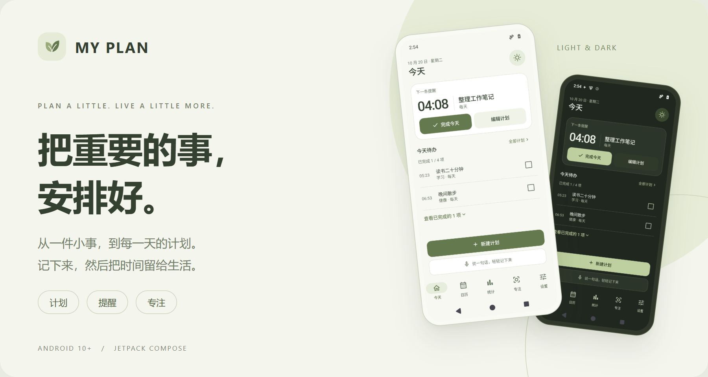
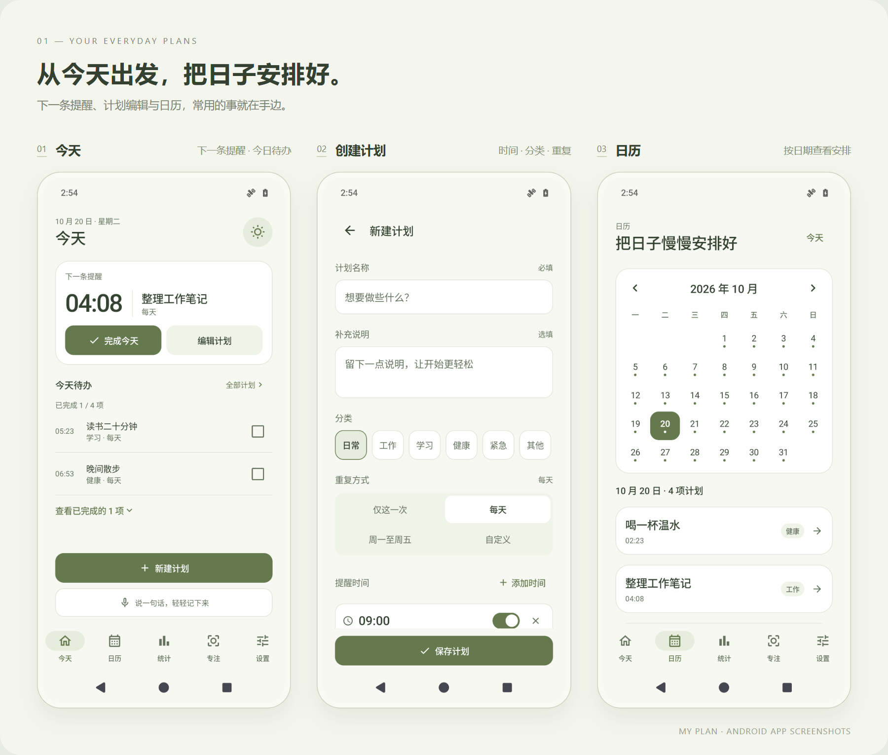
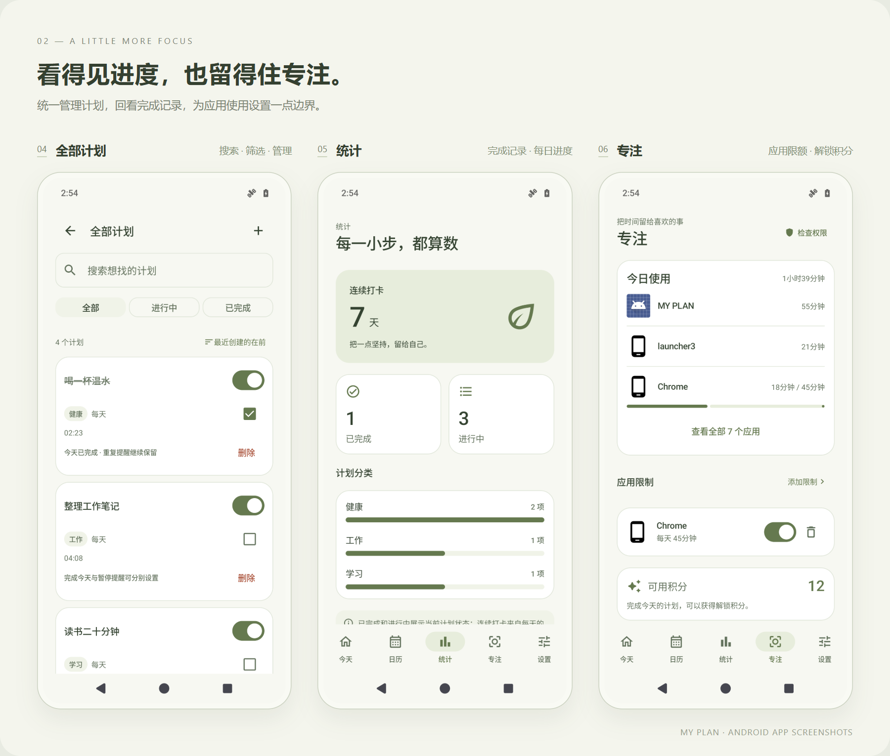
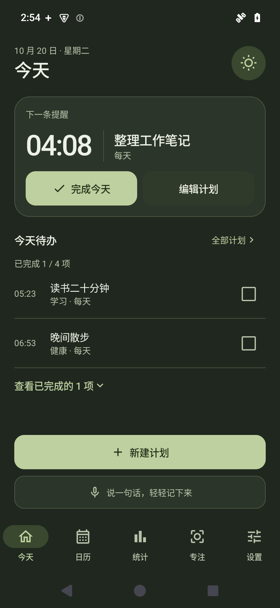
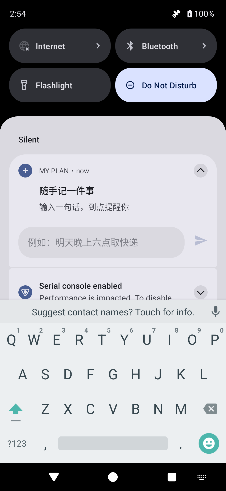

<p align="center">
  
</p>

<h1 align="center">MY PLAN</h1>

<p align="center">
  把计划记下来，把时间留给生活。<br>
  一款采用原生 Jetpack Compose 构建的 Android 个人计划提醒应用。
</p>

<p align="center">
  <strong>Android 10+</strong> &nbsp; · &nbsp; Kotlin &nbsp; · &nbsp; Jetpack Compose &nbsp; · &nbsp; <strong>v1.0.6</strong>
</p>

<p align="center">
  <a href="#界面预览">界面预览</a> &nbsp; / &nbsp;
  <a href="#开始使用">开始使用</a> &nbsp; / &nbsp;
  <a href="#本地构建">本地构建</a> &nbsp; / &nbsp;
  <a href="https://github.com/MQTQW/-/issues">问题反馈</a>
</p>

<br>

## 让每一天，更有条理

临时要办的事、每天重复的小习惯，以及想专心完成的计划，都可以放在这里。首页先呈现下一条提醒与今天待办；暖白和鼠尾草绿的界面，也有对应的深色主题。

| 记下计划 | 留意时间 | 留给专注 |
| :--- | :--- | :--- |
| **一句话安排**<br>打字或使用系统语音转写，先查看可编辑草稿，确认后保存。常用时间表达在本地解析。 | **多时段与重复提醒**<br>支持一次性、每天、工作日和自选星期；重复计划可以安排多个提醒时段。 | **计划驱动专注**<br>选择计划或具体步骤开始计时，暂时限制分心应用；完成整个计划获得积分，兑换限时使用权。 |
| **随手快记**<br>从通知栏或桌面卡片记事，查看今天待办，也可以搜索、暂停和撤销删除。 | **日历与统计**<br>按日期查看安排与完成记录，让计划和进度都看得见。 | **拆成小步骤**<br>手动维护步骤，或配置 AI 服务后生成建议；修改、勾选采纳，再保存到计划中。 |

复杂描述的 AI 理解和计划拆解需要自行部署仓库中的服务，并在应用内配置地址与访问码。当前提供 App 与接口代码，没有已部署的公共服务；简单解析、手动步骤、提醒和专注可在本地使用。详见 [一句话安排与计划拆解](docs/ai-plan-assist.md)。

## 界面预览

以下为 Android 15 模拟器中的实际应用截图，使用演示数据。点击图片可查看大图。

<p align="center">
  
</p>

<p align="center">
  
</p>

<details>
<summary><strong>再看看深色主题与通知栏快记</strong></summary>

<p align="center">
  
  &nbsp;&nbsp;
  
</p>

通知栏快记由系统 RemoteInput 提供输入入口，通知的外观随 Android 版本与手机系统而变化。

</details>

## 开始使用

当前仓库提供源码，可按下方步骤构建调试 APK。安装后可以这样开始：

1. **创建第一条计划**：填写事项、时间和重复方式，或在首页「一句话安排」中输入描述，检查草稿后确认保存。
2. **检查提醒权限**：在「设置 → 安心使用」中检查通知与精确闹钟权限，再用「测试提醒」进行一次锁屏测试。
3. **开启通知栏快记**：前往「设置 → 快捷创建 → 通知栏快记」，之后拉下通知栏即可记事。
4. **添加桌面小组件**：长按桌面空白处，在小组件列表找到「MY PLAN · 日常卡片」。查看下一条提醒和今日进度，直接完成、撤销，或点「＋」打开快速创建小窗。
5. **为一件事专注**：在「专注」选择计划、时长和分心应用。完成后确认计划，获得积分；达到每日限额的应用可用 1 积分兑换 10 分钟使用时间。详见 [计划驱动专注](docs/plan-focus.md)。
6. **拆成可以开始的一步**：在计划编辑页手动添加步骤；配置 AI 服务后，也可以使用「AI 帮我拆解」，先编辑、选择建议，再采纳保存。步骤支持单独记录进度与开始专注。

| 想记什么 | 可以这样输入 |
| :--- | :--- |
| 临时的小事 | `十分钟后喝水` |
| 明天的安排 | `明天晚上六点取快递` |
| 安排并建议专注时长 | `明晚八点提醒我读书，专注二十五分钟` |
| 固定的小习惯 | `每天晚上九点读书` |
| 工作日的计划 | `工作日早上八点开会` |

快记默认创建「仅这一次」的计划；只有明确说出重复规则时才会周期提醒。缺少时间或表达存在歧义时，会先请你确认。创建结果支持修改和撤销。详见 [通知栏快记说明](docs/notification-quick-capture.md)。

首页与快速创建小窗中的「一句话安排」先生成草稿，再由你确认保存。系统语音转写与文字共用同一套日期和重复规则；手机没有可用的系统识别服务时，可以使用键盘语音输入或直接打字。AI 服务配置与部署步骤见 [接口说明](docs/ai-service.md)。

### 关于提醒声音

「通知＋闹铃」模式使用系统闹钟音量，支持试听、停止响铃和最长一分钟的播放时限。首次使用建议在锁屏、离开应用后分别测试。

手机的通知权限、闹钟音量、勿扰规则与厂商后台管理会影响实际提醒。遇到「通知到了但没声音」，可在「设置 → 安心使用 → 响铃排查记录」中查看并导出记录。详细行为见 [闹铃与后台排查说明](docs/alarm-audio.md)。

### 数据与可选权限

- **计划保存在本机**：计划、提醒、步骤和完成记录由 Room 保存；简单时间表达的解析不依赖网络。
- **语音由系统提供**：点击「说出计划」后调用手机的系统语音识别服务，其可用性及是否联网取决于设备和服务提供方。
- **AI 按需连接**：复杂理解与拆解只发送本次输入及必要的计划上下文。应用填写专用服务访问码，模型供应商密钥留在服务端；AI 配置排除于系统云备份和设备迁移。
- **专注功能按需授权**：用量统计与应用限制需要使用情况访问、无障碍等相应权限；普通计划功能不需要开启专注权限。
- **支持导出 JSON 备份**：格式 v3 包含计划、提醒、完成历史、建议专注时长及步骤进度，不含 AI 访问码；当前尚未提供应用内导入界面。

## 本地构建

需要 **JDK 17**、**Android SDK Platform 35** 和 **Build Tools 35.0.0**。也可以用 Android Studio 打开项目，由 Gradle Wrapper 构建。

```bash
git clone https://github.com/MQTQW/-.git my-plan
cd my-plan
```

将 [`local.properties.example`](local.properties.example) 复制为 `local.properties`，填写本机 `sdk.dir`。构建与本地测试无需真实 API 密钥，两项旧服务密钥保持留空。新入口的系统语音转写无需这些密钥；可选 AI 服务在应用设置中配置。

**Windows / PowerShell**

```powershell
.\gradlew.bat testDebugUnitTest lintDebug assembleDebug
```

**macOS / Linux**

```bash
java -classpath gradle/wrapper/gradle-wrapper.jar org.gradle.wrapper.GradleWrapperMain \
  testDebugUnitTest lintDebug assembleDebug
```

生成的 APK：`app/build/outputs/apk/debug/app-debug.apk`。

Windows 环境排查、数据库迁移和测试范围见 [开发说明](docs/development.md)。可选 AI 服务使用 Node.js 22+，代码位于 `server/ai-assist`，运行与 HTTPS 部署要求见 [AI 服务说明](docs/ai-service.md)。`local.properties` 和真实服务端 `.env` 均不应提交，APK 不应包含长期模型密钥。

## 项目结构

```text
app/src/main/java/com/example/myplan/
├── assistant/      统一计划草稿、系统语音入口与 AI 服务客户端
├── data/           计划、步骤、完成记录、设置与 Room 数据库
├── notification/   闹钟调度、通知、声音播放与排查记录
├── quickadd/       通知栏快记、本地时间解析与确认小窗
├── widget/         桌面日常卡片、完成与撤销
├── focus/          计划专注、使用统计、应用限额与限时积分解锁
├── ui/             Compose 页面、导航、共享组件与主题
└── voice/          旧版语音实现与兼容数据模型

app/src/test/       本地回归测试
app/schemas/        Room 数据库结构
design/            界面设计源文件与设计说明
docs/              功能说明与开发文档
server/ai-assist/   可自行部署的 AI 理解与步骤拆解接口
```

界面采用 **Kotlin + Jetpack Compose / Material 3**，状态由 **ViewModel、Flow 与 Coroutines** 管理，数据使用 **Room**，定时提醒使用 **AlarmManager**，网络请求使用 **OkHttp**。当前验证范围与已知限制记录在 [开发说明](docs/development.md#测试与验收) 中。

## 反馈与参与

欢迎通过 [Issues](https://github.com/MQTQW/-/issues) 提交问题或建议，也欢迎提交 Pull Request。反馈提醒问题时，请附上应用版本、机型、Android / ColorOS 版本、复现步骤，以及可用的响铃排查记录；发布前请检查并移除个人信息。

本页排版参考了 [AppFlowy](https://github.com/AppFlowy-IO/AppFlowy) 的项目导览和 [Material Files](https://github.com/zhanghai/MaterialFiles) 的界面展示方式；封面与展示图为本项目制作，应用界面来自实际运行截图。

---

<p align="center">
  <strong>MY PLAN</strong><br>
  计划、提醒与专注，放在一起。
</p>
