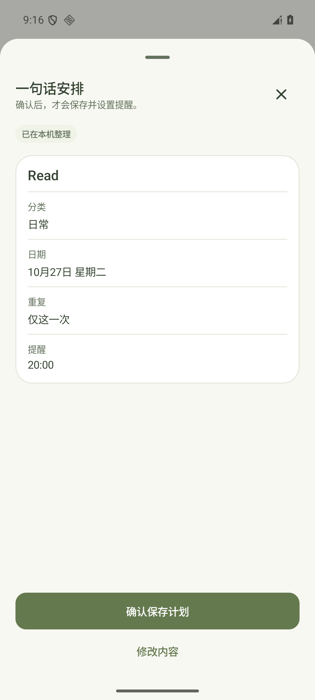
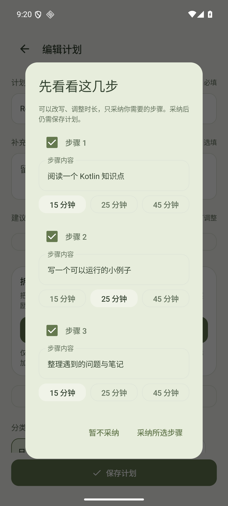
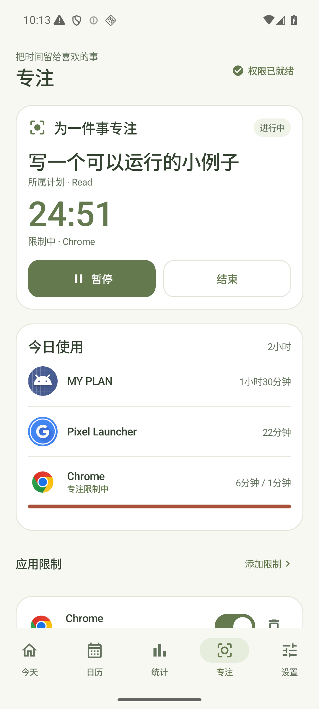

# 一句话安排与计划拆解

v1.0.6 将「想到一件事」和「开始做一步」接入现有计划页面。文字与系统语音转写使用同一套计划草稿流程，AI 的结果需要经过预览和确认；提醒、步骤进度、专注、积分与响铃继续在手机本地运行。

当前交付包含 Android App 和 `server/ai-assist` 接口源码，没有购买服务器、部署公共接口，也没有使用真实模型密钥进行在线验证。简单表达的本地解析与手动步骤可以直接使用；复杂理解和 AI 拆解需要自行部署服务，并在应用中配置地址与访问码。部署方法见 [AI 服务说明](ai-service.md)。

以下为 API 36 模拟器中的实际界面，使用测试数据。中间的拆解建议来自模拟上游协议测试服务，不代表真实模型生成效果。

  
  
  

## 一句话安排

在首页或快速创建小窗打开「一句话安排」，输入文字，或点击「说出计划」调用系统语音识别。转写结果先进入输入框，再与文字走同一条流程：

**输入或转写 → 整理草稿 → 查看和修改 → 确认保存 → 本地安排提醒。**

| 可以尝试的表达 | 对应安排 |
| --- | --- |
| `十分钟后喝水` | 未来时间的一次性提醒 |
| `明晚八点提醒我读书，专注二十五分钟` | 一次性日期、提醒时间与建议专注时长 |
| `每天晚上九点读书` | 每天重复 |
| `工作日早上八点开会` | 周一至周五重复 |

日期和时间明确的简单表达优先在本地解析；需要复杂理解时，才使用已配置的 AI 服务。界面区分本机整理和 AI 整理，不把规则解析称为模型调用。未配置服务时，可以补充明确时间或改用手动创建。

草稿支持一次性日期、每天、工作日和自选星期。重复计划可以设置多个不重复的提醒时段；一次性计划使用一个未来日期和时间。建议专注时长支持 15／25／45 分钟，开始专注前仍可调整。隔周、每月、每年等周期暂不支持，不能自动当成每天保存。

信息不足时先补充，生成草稿后还可以修改名称、分类、日期、重复方式和提醒时间，再确认保存。关闭入口、切换到其他页面或修改输入时，未完成的解析会取消；仅收到 AI 响应不会创建计划，也不会扣积分。

系统语音依赖手机安装的识别服务及其语言支持，是否联网由服务提供方决定。手机没有相应服务时，可以使用键盘语音输入或直接打字。首页新入口不使用旧版自建云 ASR / TTS，不能保证所有设备都支持系统转写，也不宣称系统语音完全离线。

## 把计划拆成小步骤

在计划编辑页的「拆成小步骤」中，可以离线手动添加步骤；配置服务后，也可点击「AI 帮我拆解」。AI 只接收本次拆解所需的标题与说明，不读取整个计划库。

生成结果先以建议展示。你可以修改标题和 15／25／45 分钟时长、取消不需要的建议，再选择采纳。已有步骤时可以追加，或确认替换；采纳后仍需保存计划，才会写入本地数据。

每个计划最多 8 个步骤，每个标题最多 120 字。步骤不会自动产生独立提醒。编辑已有步骤保留其稳定标识与进度；删除计划后，在撤销窗口内恢复时，步骤和完成状态也一起恢复。

保存后可以勾选步骤，或点击「专注这一步」。步骤专注结束后由用户确认，只完成这一步，不标记父计划完成、不发积分。整个计划即使所有步骤都完成，也仍需单独确认，沿用原来的完成奖励。循环计划按本地日期判断步骤完成，一次性计划跨天保留步骤进度。暂停、继续与应用限制规则见 [计划驱动专注](plan-focus.md)。

## 配置 AI 服务

在「设置 → AI 计划助手」填写完整的 `/v1/assist` 接口地址和服务部署者提供的专用访问码。模型供应商的 API 密钥只放在服务端，不填入 App 的访问码输入框。公网接口需要 HTTPS；调试构建只对文档列出的本地地址允许 HTTP。

没有服务地址和访问码时，复杂理解和 AI 拆解不会可用；本地支持的解析、手动计划、手动步骤、提醒及专注继续使用。清除 AI 服务配置不会删除计划或步骤。网络错误、访问码错误、超时和无效输出会提示用户，不替用户自动保存。

本机 AI 配置使用独立 SharedPreferences 保存，排除于 Android 系统云备份和设备迁移。JSON v3 计划备份包含建议专注时长、有序步骤和完成状态，不含 AI 服务地址、访问码或模型密钥。当前仍没有应用内导入界面。

## 实现与验证范围

`PlanDraftWorkflow` 统一文字和转写后的解析与校验，`AssistCaptureViewModel` 管理草稿、取消和显式确认；保存继续经过共享 `PlanActions` 与 Room 事务。服务只返回计划草稿或步骤建议，不能发起提醒、修改手机数据或扣积分。Android 和服务端分别校验日期、周期、时段、时长及输出字段。

本版本通过 209 项单元 / Robolectric 测试，失败、错误、跳过均为 0；Lint 0 错误、83 条警告。Node 服务的 14 项本地测试使用模拟上游，覆盖鉴权、限流、字段、时间、取消与错误处理。

API 36 模拟器中的本地一次性预览未写库，确认后新增 1 个计划；配置协议测试服务后，复杂解析和拆解链路可达，预览与采纳仍未写库，保存后只保留选中的 2 步。桌面小组件「＋」打开的快速创建小窗也经过智能整理、确认保存并返回桌面。步骤勾选与步骤专注确认均未完成父计划或发积分。

步骤计时的 READY 验收将测试数据剩余时间压缩到 15 秒，生产 25 分钟时长未改变。深色、360×640 dp 与两倍字体下已检查草稿跨配置变化保留、正文滚动及固定确认和修改按钮。真实模型语义和公开部署尚未验证，模拟响应通过不能代替真实中文表达和目标手机系统语音的验收。
