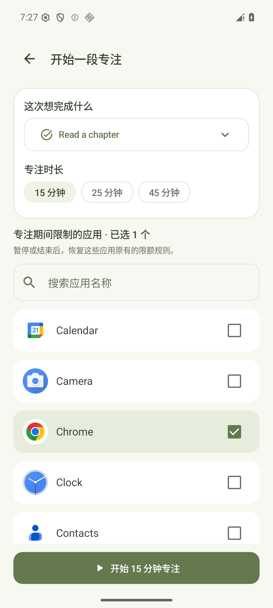
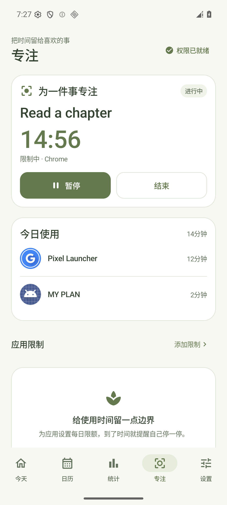
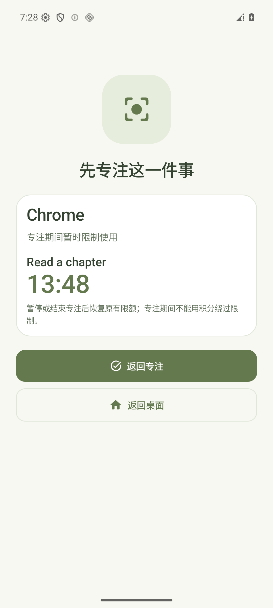

# 计划驱动专注与限时解锁

v1.0.5 将计划、应用限制和积分兑换连接起来，数据和规则均在手机本地运行，无需账号或服务器。

以下为 Android 16 模拟器中的实际界面，使用演示数据。

  
  
  

## 使用流程

1. 在「专注 → 为一件事专注」中选择启用且尚未完成的计划、15／25／45 分钟时长，以及本次希望限制的应用；计划不必在今天设置提醒。
2. 开启使用情况访问和 MY PLAN 无障碍服务后开始。倒计时期间，所选应用会出现专注拦截页；可从拦截页返回专注页面。
3. 暂停时停止计时并解除本次会话的应用限制。继续会恢复本次限制；结束不会自动完成计划，也不会发放积分。
4. 计时结束后点击「确认完成计划」。沿用原有完成奖励，专注本身不额外发奖；已在其他入口完成或被修改、暂停、删除的计划，不会被旧会话再次完成。
5. 某应用达到每日限额后，可以使用 **1 积分兑换该应用 10 分钟临时使用权**。从兑换成功起立即计时，离开应用也继续；有有效授权时不重复扣分或延长时间。

所选应用正在受到本次专注限制时，积分解锁不能绕过它。暂停或结束专注后，仍按应用原有的每日限额和有效临时授权决定是否可用。到期恢复当时有效的限额规则；期间若修改或删除了限额，不会恢复旧规则。

应用本身、桌面、系统设置、电话及输入法等必要入口不会进入专注限制列表，用户始终可以返回专注页面或系统设置。普通专注与限额拦截由无障碍服务触发专用拦截页，不将悬浮窗授权作为这条流程的前置条件。

## 恢复与跨天规则

- 同一次开机内结束后台进程后，依据单调时钟和保存的起始状态恢复倒计时，不依赖持续每秒写数据库。
- 手机重新开机后，进行中的专注自动暂停，保留最近一次开始、暂停或继续时保存的剩余时长，用户可确认后继续；不将关机时间自动计为专注，也不自动发奖。
- 跨本地日期后，未结束会话取消，临时授权失效，按新一天的限额和积分规则处理。
- 修改系统时间不能延长已有临时授权。已打开的受限应用在授权到期时也会重新核对，而不只在下一次打开应用时核对。
- 升级前已存在的「当天解锁」保留到原本的日切；新版本的积分兑换均写入限时授权，不再设置该旧标记。

## 实现

PlanDatabase 以保留数据的 v6→v7 迁移增加 `focus_sessions` 和 `timed_unlocks`。专注状态为 RUNNING、PAUSED、READY、COMPLETED、CANCELLED，当前会话采用单行记录，避免同时运行多段专注。

确认完成在共享 `PlanActions` 操作锁内进入同一个 Room 事务，检查会话状态、日期、计划修改时间及启用 / 完成状态后，将计划完成、原有积分奖励和会话确认一同提交。奖励沿用原计划的去重规则：重复计划按本地日期记录，一次性计划保留首次完成日期。授权记录与积分扣除也在同库事务内提交；有效授权期间的新请求复用原截止时间，旧请求到期后重试不会再次扣分，需要新的兑换请求才能重新授权。

无障碍服务在应用窗口变化、数据变化和最近截止点重新读取有效规则。系统重新连接服务时，从当前窗口恢复前台应用，仅读取包名。运行中的专注限制优先于旧的当天解锁和新的限时授权。输入法窗口不覆盖被限制应用的前台记录，确保输入过程中到期也能重新核对。

复用既有用量监控前台服务显示专注倒计时，结束后通知用户确认。计时通知不走计划闹铃播放服务，也不自动完成计划。

## 自动化验证

v1.0.5 已通过 `testDebugUnitTest`、`lintDebug` 与 `assembleDebug`。实际 XML 汇总为 **153 项测试通过，失败 / 错误 / 跳过均为 0；Lint 0 错误、83 条警告**。

- 持久化与时间：文件数据库关闭重开、同次开机内的恢复、暂停 / 继续、重启暂停、跨天失效、系统时间变化。
- 完成与积分：到时待确认、共享完成入口、重复确认和外部完成去重、数据库写入失败时整体回滚。
- 限时兑换：固定 1 积分 / 10 分钟、有效授权复用、旧请求到期重试、并发消费、授权写入失败后的积分回滚。
- 应用拦截：到期恢复当前限额、专注限制优先、必要系统入口保留、无障碍权限精确匹配、输入法窗口及桌面小组件事件不掩盖当前受限应用、重复进入仍可拦截、服务重新连接后无需切换应用也能到期拦截。
- 升级：v6→v7 保留已有计划、提醒、完成历史与积分账本，同时通过原有迁移链的回归检查。

## 原生操作验证

Android 16 模拟器在断网条件下验证了开始、暂停 / 继续、重复打开受限应用、结束、完整 15 分钟计时到待确认、确认完成和积分兑换。计时结束前后未确认时没有奖励，确认后只记一笔奖励；中途结束没有完成计划或增加奖励。后台进程结束并重建后，倒计时按原有锚点继续。

已验证有效授权期间可以使用应用，以及服务在应用已打开后重新连接时，授权到期仍会主动拦截。该到期用例将演示数据的截止时间压缩为 45 秒；应用正式兑换时长保持 10 分钟。原生验证还覆盖了浅色 / 深色、小屏两倍字体和覆盖升级数据保留。模拟器结果不能替代目标手机的厂商后台策略验收。
