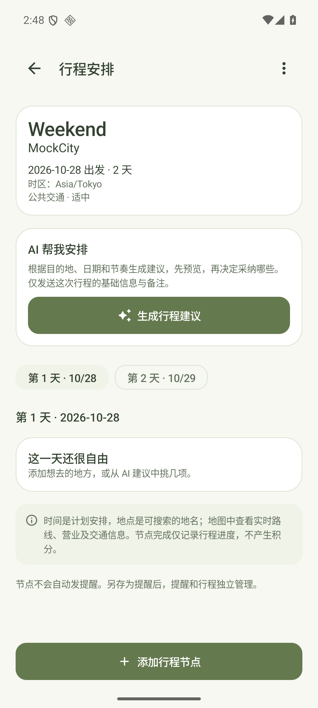
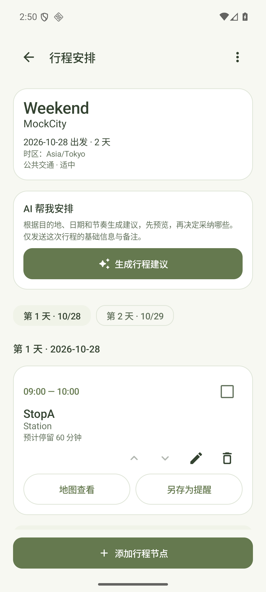
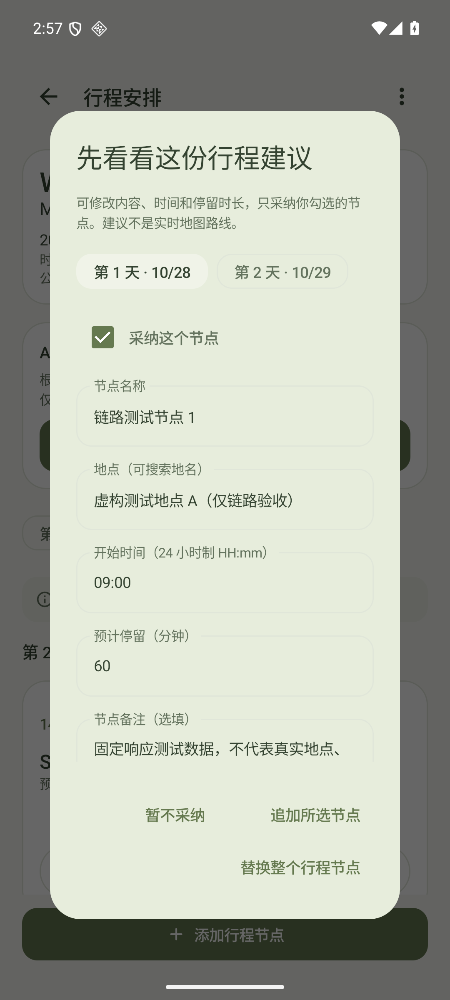

# 行程规划

v1.0.7 新增旅行与出行规划。入口位于首页右上角地图按钮，以及「日历 → 行程规划」。行程在本机单独保存，不改变日常计划的打卡、专注和积分规则。

以下为 API 36 模拟器中的原生验收截图，使用虚构测试数据；AI 预览来自本地模拟上游，不代表真实模型或实际旅行推荐。

  
  
  

## 创建和安排

创建旅行时填写名称、目的地、出发日期和 1～14 天的天数，选择出行方式、节奏和行程时区。默认时区为手机时区；跨时区出行时，请改为目的地所采用的时区，例如 `Asia/Tokyo`。时区采用 IANA 名称，不随手机之后切换时区而改变。

在每天的时间线中添加节点，填写活动名称、地点、24 小时制开始时间、预计停留时长和备注。每一天最多 12 个节点；节点时长为 1～720 分钟。手动安排不需要 AI 或服务器。

节点按你保存的顺序展示，可以上移或下移；修改顺序不会偷偷修改已填写的时间。顺序与时间不一致、节点时间重叠时会提示，可自行调整。重叠检查包括跨午夜延续到次日的节点，不计算两个地点之间的真实路程或交通用时。

可以勾选已完成的节点，进度只属于这次旅行，不会增加计划打卡或积分。编辑与删除需要明确操作；减少行程天数若会丢弃已有节点，会拒绝保存并请你先调整节点。删除旅行会一并删除它的节点。

日历会在行程日期显示标记，并展示当天所属的旅行和节点数量。日历中的旅行日期按该行程当地日期展示。

## 地图与提醒

「地图」将目的地和节点地点作为搜索内容交给手机上的地图应用，由地图应用提供搜索和导航。它不会在 MY PLAN 中显示已验证的路线、距离、交通预测或门票信息。没有可用地图应用时，会复制地点供你自行查找。实现采用 Android 的 [地图搜索 Intent](https://developer.android.com/guide/components/google-maps-intents#search-for-a-location)，不固定某一家地图应用。

「另存为提醒」先打开已有计划编辑页，确认保存后才创建一次性提醒。节点时间先按行程时区换算为绝对时间，再按手机时区显示，实际时刻保持一致。已过去、已完成或受夏令时影响而不存在／有歧义的时间不能创建提醒。

提醒另存后作为独立计划管理。之后编辑或删除旅行、节点，不会同步修改或取消这条提醒；需要在计划页面单独调整。相同节点、相同时刻生成的提醒草稿使用相同创建令牌，避免重复确认生成多条；调整节点时间后另存属于新的提醒。

## AI 行程草稿

配置已有的 AI 服务地址和访问码后，可根据目的地、日期、天数、出行方式、节奏与备注生成分日建议。模型供应商密钥仍只放在服务端；没有配置时可以继续手动规划。

AI 建议先独立预览，可以编辑时间、地点、时长和备注，取消不需要的节点，再追加到原行程，或经确认后替换原节点。只生成或浏览建议不写入行程；离开页面或修改行程时会取消尚未完成的生成，避免晚到结果覆盖当前安排。

接口要求每天 1～6 个建议节点、天数及日期有效、节点按开始时间排列且不重叠、不跨午夜。手动安排仍允许重叠或跨午夜，并显示冲突提示。AI 结果只用于规划建议，不连接实时地图、天气、营业时间或交通数据，请在地图及相关官方渠道核对后出行。

当前交付只有 App 与可部署的接口源码，没有部署公网服务，也没有使用真实模型验证生成质量；协议测试使用虚构地点和模拟上游。接入方法与 `itinerary` 契约见 [AI 服务说明](ai-service.md)。

## 数据与边界

行程和节点使用独立的 `travel.db`（Room v1）；计划数据库仍为 v8，不清空或重写已有计划。节点通过外键关联旅行，批量采纳和调整在事务内保存。

当前「导出计划备份」仍是原有 JSON v3，不含旅行数据库，也没有行程导入功能。清除应用数据或卸载前，应自行记录需要保留的行程。AI 服务配置不在计划备份、系统云备份或设备迁移中。
