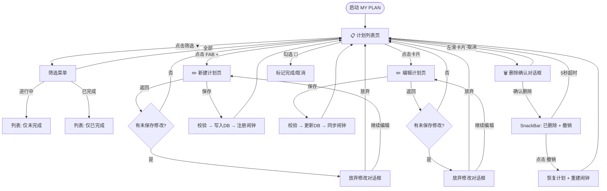
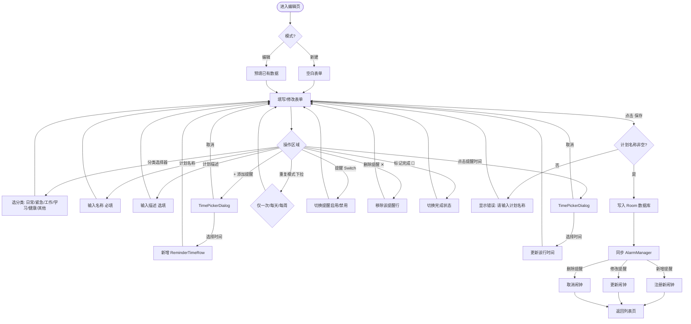
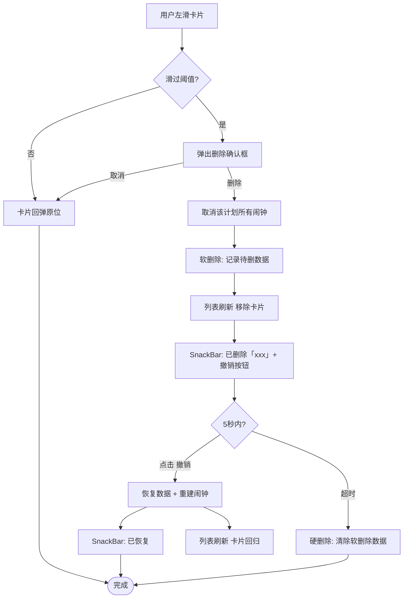
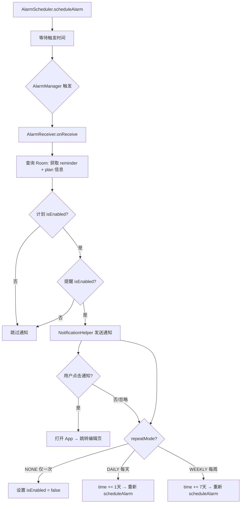
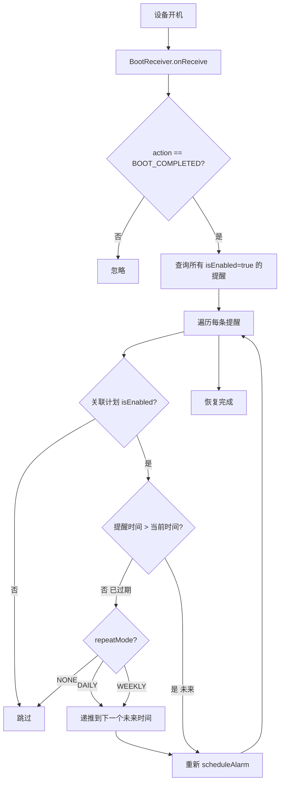
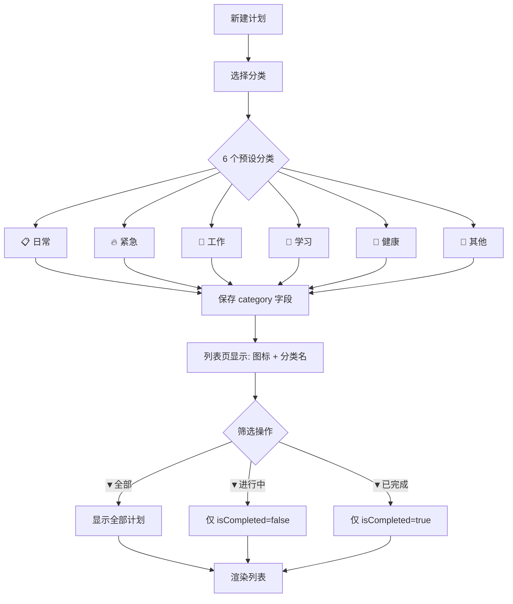

# MY PLAN - Kotlin 原生 Android 计划提醒应用实施方案

## Context

用户需要在 Android 手机上使用的计划提醒软件，核心功能：设定计划、设置多个提醒时间、在设定时间通过系统通知提醒。项目从零开始在 `e:\计划软件` 目录构建。

### 已确认的技术选型
- **语言/框架**: Kotlin + Jetpack Compose 原生 Android
- **提醒方式**: 系统本地通知（Notification + AlarmManager）
- **数据存储**: SQLite（Room）
- **App 名称**: MY PLAN
- **包名**: com.example.myplan
- **最低版本**: Android 10 (API 29)
- **V1 功能范围**: 完整版（计划 CRUD + 多提醒 + 完成状态标记 + 筛选）

## 架构设计

### 分层架构 (MVVM)
```
Compose UI (Screens) → ViewModel (StateFlow) → Repository → Room DAO ↔ SQLite
                                                          → AlarmScheduler ↔ AlarmManager
```

### 导航路由
- `plan_list` — 计划列表首页
- `plan_edit/{id}` — 编辑已有计划
- `plan_edit/new` — 新建计划

## 数据模型

### PlanEntity（计划表）
| 字段 | 类型 | 说明 |
|------|------|------|
| id | Long | 主键自增 |
| name | String | 计划名称（必填） |
| description | String? | 计划描述 |
| category | String | 分类：`日常` / `紧急` / `工作` / `学习` / `健康` / `其他` |
| isEnabled | Boolean | 是否启用提醒 |
| isCompleted | Boolean | 是否已完成 |
| createdAt | Long | 创建时间戳 |
| updatedAt | Long | 修改时间戳 |

### ReminderEntity（提醒表）
| 字段 | 类型 | 说明 |
|------|------|------|
| id | Long | 主键自增 |
| planId | Long | 外键 → PlanEntity.id（CASCADE 删除） |
| time | Long | 提醒时间戳（精确到分钟） |
| repeatMode | String | 重复模式：`NONE` / `DAILY` / `WEEKLY` |
| isEnabled | Boolean | 该提醒是否启用 |
| createdAt | Long | 创建时间戳 |

### 一对多关系
```kotlin
data class PlanWithReminders(
    @Embedded val plan: PlanEntity,
    @Relation(parentColumn = "id", entityColumn = "planId")
    val reminders: List<ReminderEntity>
)
```

## 文件清单（约 30 个源文件）

### Gradle 构建配置
- `settings.gradle.kts` — 项目设置
- `build.gradle.kts` — 根构建脚本
- `gradle.properties` — Gradle 属性
- `gradle/libs.versions.toml` — 版本目录
- `gradle/wrapper/gradle-wrapper.properties` — Wrapper 配置
- `app/build.gradle.kts` — App 模块构建脚本（namespace: com.example.myplan, compileSdk: 36, minSdk: 29, targetSdk: 36）

### 核心依赖版本
- AGP 9.2.0 / Kotlin 2.4.0 / KSP 2.4.0-1.0.30
- Compose BOM 2026.05.00 / Material 3
- Room 2.8.4 / Navigation Compose 2.9.5（使用 Nav2 稳定版）
- Lifecycle 2.9.1 / Coroutines 1.10.1

### 数据层
- `app/src/main/java/com/example/myplan/data/local/PlanDatabase.kt` — Room 数据库
- `app/src/main/java/com/example/myplan/data/local/entity/PlanEntity.kt`
- `app/src/main/java/com/example/myplan/data/local/entity/ReminderEntity.kt`
- `app/src/main/java/com/example/myplan/data/local/dao/PlanDao.kt`
- `app/src/main/java/com/example/myplan/data/local/dao/ReminderDao.kt`
- `app/src/main/java/com/example/myplan/data/local/relation/PlanWithReminders.kt`
- `app/src/main/java/com/example/myplan/data/repository/PlanRepository.kt`

### UI 层
- `app/src/main/java/com/example/myplan/ui/theme/Theme.kt` — Material 3 主题
- `app/src/main/java/com/example/myplan/ui/theme/Color.kt`
- `app/src/main/java/com/example/myplan/ui/theme/Type.kt`
- `app/src/main/java/com/example/myplan/ui/navigation/AppNavGraph.kt` — 导航图
- `app/src/main/java/com/example/myplan/ui/screen/planlist/PlanListScreen.kt` — 首页列表
- `app/src/main/java/com/example/myplan/ui/screen/planlist/PlanListViewModel.kt`
- `app/src/main/java/com/example/myplan/ui/screen/planedit/PlanEditScreen.kt` — 新建/编辑
- `app/src/main/java/com/example/myplan/ui/screen/planedit/PlanEditViewModel.kt`
- `app/src/main/java/com/example/myplan/ui/component/PlanCard.kt` — 计划卡片
- `app/src/main/java/com/example/myplan/ui/component/ReminderTimeRow.kt` — 提醒时间行

### 通知系统
- `app/src/main/java/com/example/myplan/notification/NotificationHelper.kt` — 通知渠道与构建
- `app/src/main/java/com/example/myplan/notification/AlarmScheduler.kt` — 闹钟调度
- `app/src/main/java/com/example/myplan/notification/AlarmReceiver.kt` — 广播接收器
- `app/src/main/java/com/example/myplan/notification/BootReceiver.kt` — 开机恢复

### 入口
- `app/src/main/java/com/example/myplan/MyPlanApp.kt` — Application 类
- `app/src/main/java/com/example/myplan/MainActivity.kt` — 入口 Activity
- `app/src/main/AndroidManifest.xml` — 清单文件

## 视觉主题：活泼可爱风（✅ 已定稿）

### 设计理念
像朋友发来的鼓励消息——明亮、轻快、有生命力。用 Emoji 做主视觉元素，卡片像彩色便签纸。

### 设计稿
- 首页：`e:\计划软件\design\bp3YU.png`
- 编辑页：`e:\计划软件\design\t7douW.png`
- Pencil 源文件：`e:\计划软件\pencil-jihua.pen`

### 色彩体系（明亮活泼）

| 角色 | 色值 | 用途 |
|------|------|------|
| 背景色 | `#FFFBF5`（暖白） | 页面底色 |
| 卡片-黄 | `#FFF9E6` | 日常类计划卡片 |
| 卡片-珊瑚 | `#FFF0ED` | 健康类计划卡片 |
| 卡片-薰衣草 | `#F5F0FA` | 学习类计划卡片 |
| 主文字 | `#4A3530`（深棕） | 标题、名称 |
| 副文字 | `#9B8579`（柔和棕） | 描述、标签 |
| 强调色 | `#FF7B5C`（珊瑚橙） | 按钮、Toggle、FAB |
| 强调浅色 | `#FFE8E0` | 标签底色、选中背景 |
| 分割线 | `#F0E8E0` | 列表分隔 |

### 形状与间距
- 卡片圆角：28dp
- 按钮/标签圆角：16dp
- FAB：正圆形，60dp，带珊瑚橙投影
- 页面水平边距：24dp
- 卡片内边距：16-18dp
- 卡片间距：14dp
- 卡片阴影：y=3, blur=12, #E8D5C8

### 装饰元素
- 问候区：大号 Emoji 太阳 + "下午好呀 👋" + 星星闪烁 ✨⭐
- 卡片分类：Emoji 前缀（📖💪📚）
- 底部鼓励语：🌸 "今天也要加油哦" / "每个计划都是一颗种子" 🌸

### 动画
| 位置 | 效果 | 时长 |
|------|------|------|
| 完成勾选 | 卡片背景短暂泛鼠尾草绿 + 名称删除线平滑划过 + Checkbox 弹跳 | 400ms |
| 列表项进出 | `animateItemPlacement()` 平滑移位 | 300ms |
| FAB 按压 | 缩放反馈（按下 95%，松开弹回） | 200ms |
| 空状态切换 | 图标淡入淡出 `AnimatedVisibility` | 300ms |
| 删除滑出 | SwipeToDismiss 卡片滑出 + 淡出 | 标准 |
| SnackBar | 底部滑入 + 5 秒后滑出 | 300ms |

### 图标风格
- 使用 Material Icons Rounded 系列（圆角图标，与 20dp 卡片圆角统一）
- 空状态图标：羽毛笔 `EditNote` 或 灯泡 `Lightbulb`（比 clipboard 更有温度）
- 时钟图标：`Schedule`（Material 圆角风格）

### 字体
- 使用系统默认中文字体（Noto Sans CJK 或系统字体）
- 计划名称：18sp，SemiBold
- 描述文字：14sp，Regular
- 提醒时间：14sp，Medium
- 标题（TopAppBar）：20sp，SemiBold
- 空状态提示：16sp，Medium
- 按钮文字：14sp，Medium

## UI 设计（共 2 个主页面 + 3 个交互组件）

---

### 页面 1：计划列表页（首页）

**这是用户打开 App 看到的主页面。**

#### TopAppBar 区域
```
┌──────────────────────────────────────────────┐
│  ☰ MY PLAN                          [▼全部] │
└──────────────────────────────────────────────┘
```
- 左侧：App 名称 "MY PLAN"，使用粗体 title 字体
- 右侧：筛选按钮，显示当前筛选状态（"▼全部" / "▼进行中" / "▼已完成"）
  - 点击弹出 DropdownMenu，三个选项：全部 / 进行中 / 已完成
  - 当前选中项高亮，旁边有 ✓ 标记
  - 默认选中"全部"

#### 有数据时的列表
```
┌──────────────────────────────────────────────┐
│ ┌────────────────────────────────────────┐   │
│ │ 📋 日常                                │   │
│ │ ☐  每日阅读            [启用 ⬤──]      │   │
│ │    每天阅读30分钟书籍                   │   │
│ │    ⏰ 下次提醒: 08:30                  │   │
│ └────────────────────────────────────────┘   │
│ ┌────────────────────────────────────────┐   │
│ │ 💪 健康                                │   │
│ │ ☑  健身计划            [禁用 ⬤──]      │   │
│ │    每周三次力量训练...                  │   │
│ │    ⏰ 提醒已禁用                        │   │
│ └────────────────────────────────────────┘   │
│ ┌────────────────────────────────────────┐   │
│ │ 📖 学习                                │   │
│ │ ☑  学习Kotlin ~~(已完成)~~             │   │
│ │    完成Compose课程...                   │   │
│ └────────────────────────────────────────┘   │
│                                              │
│                          ┌──┐                │
│                          │+ │  FAB           │
│                          └──┘                │
└──────────────────────────────────────────────┘
```

**PlanCard 组件**（每张卡片包含）：
| 位置 | 元素 | 说明 |
|------|------|------|
| 左上 | 分类标签 | 图标 + 分类名，如 `📋 日常`，14sp 焦糖灰 |
| 左中 | Checkbox | 完成状态选框，勾选后计划名加删除线 |
| 右上 | Switch 开关 | 控制该计划所有提醒的启用/禁用 |
| 中上 | 计划名称 | 粗体，已完成的计划显示删除线 + 灰色 |
| 中下 | 描述文字 | 灰色，最多 2 行，超出用 `...` 省略 |
| 左下 | 下次提醒 | 时钟图标 + "08:30" 或 "提醒已禁用" |

**卡片交互**：
- **点击卡片** → 跳转到编辑页（传入 planId）
- **左滑卡片** → 显示红色删除背景 + 🗑 图标 → 滑过阈值后弹出删除确认对话框
- **点击 Checkbox** → 切换完成状态（动画过渡）
- **点击 Switch** → 切换启用/禁用状态

#### 空状态（列表为空时）
```
┌──────────────────────────────────────────────┐
│  ☰ MY PLAN                          [▼全部] │
│                                              │
│                                              │
│                  📋                          │
│              还没有计划                       │
│     点击右下角 + 创建你的第一个计划            │
│                                              │
│                                              │
│                          ┌──┐                │
│                          │+ │  FAB           │
│                          └──┘                │
└──────────────────────────────────────────────┘
```
- 居中大图标（clipboard 或 plan 相关的 Material Icon）
- 主提示文字（16sp，灰色粗体）
- 副提示文字（14sp，浅灰）
- FAB 依然可见

#### FAB（悬浮操作按钮）
- 右下角固定位置
- 圆形，主题色背景，白色 "+" 图标
- 点击 → 导航到新建计划页

---

### 页面 2：计划编辑页（新建 / 编辑共用）

**新建模式 vs 编辑模式的差异：**
- TopAppBar 标题：新建模式显示"新建计划"，编辑模式显示"编辑计划"
- 编辑模式额外显示"完成状态"行
- 编辑模式预填已有数据

#### 新建模式布局
```
┌──────────────────────────────────────────────┐
│  ← 新建计划                          [保存]  │
│──────────────────────────────────────────────│
│                                              │
│  分类: [📋 日常 ▼]                           │
│                                              │
│  ┌─ 计划名称 ──────────────────────────┐     │
│  │ 输入你的计划名称...                   │     │
│  └──────────────────────────────────────┘     │
│                                              │
│  ┌─ 描述（选填）────────────────────────┐     │
│  │ 写点什么...                           │     │
│  │                                       │     │
│  └──────────────────────────────────────┘     │
│                                              │
│  ── 提醒时间 ────────────────────────────    │
│                                              │
│  ┌──────────────────────────────────────┐    │
│  │ 🕐 08:30  [每天]  [⬤启用]      ✕   │    │
│  └──────────────────────────────────────┘    │
│  ┌──────────────────────────────────────┐    │
│  │ 🕐 12:00  [仅一次] [⬤启用]     ✕   │    │
│  └──────────────────────────────────────┘    │
│  ┌──────────────────────────────────────┐    │
│  │ 🕐 21:00  [每周]  [◎禁用]      ✕   │    │
│  └──────────────────────────────────────┘    │
│                                              │
│  ┌─ + 添加提醒时间 ──────────────────────┐   │
│  └───────────────────────────────────────┘   │
│                                              │
└──────────────────────────────────────────────┘
```

#### 编辑模式布局（多一个完成状态行）
```
┌──────────────────────────────────────────────┐
│  ← 编辑计划                          [保存]  │
│──────────────────────────────────────────────│
│                                              │
│  分类: [📋 日常 ▼]                           │
│                                              │
│  ┌─ 计划名称 ──────────────────────────┐     │
│  │ 每日阅读                              │     │
│  └──────────────────────────────────────┘     │
│                                              │
│  ┌─ 描述（选填）────────────────────────┐     │
│  │ 每天阅读30分钟书籍                     │     │
│  └──────────────────────────────────────┘     │
│                                              │
│  标记为已完成                    [☐  ]      │
│                                              │
│  ── 提醒时间 ── (3个) ──────────────────    │
│  ... 同上 ...                               │
└──────────────────────────────────────────────┘
```

#### 编辑页各组件详述

**TopAppBar**：
- 左侧：返回箭头 ←，点击行为：
  - 如果内容未修改 → 直接返回
  - 如果内容已修改且未保存 → 弹出确认对话框："有未保存的更改，确定放弃吗？" → [放弃并退出] / [继续编辑]
- 标题：动态显示"新建计划"或"编辑计划"
- 右侧：文字按钮"保存"，theme primary 颜色

**分类选择器**：
- TopAppBar 下方，计划名称上方
- 格式：`分类: [📋 日常 ▼]`，显示当前选中的分类图标和名称
- 点击弹出 DropdownMenu，列出 6 个预设分类：📋 日常 / 🔥 紧急 / 💼 工作 / 📖 学习 / 💪 健康 / 📌 其他
- 新建模式默认选中"日常"，编辑模式显示已有分类

**计划名称输入框**：
- Material 3 OutlinedTextField
- placeholder: "输入你的计划名称..."
- 单行输入
- 保存时校验：如果为空，显示红色边框 + 下方错误文字 "请输入计划名称"

**计划描述输入框**：
- Material 3 OutlinedTextField
- placeholder: "写点什么..."
- 多行，最多 3 行高度
- 非必填

**完成状态行**（仅编辑模式）：
- 左侧文字："标记为已完成"
- 右侧 Checkbox
- 勾选后，返回列表页该计划名称会加删除线

**提醒时间区域**：
- 分隔线 + 标题：`── 提醒时间 ──`，如果有提醒则加上数量 `── 提醒时间 (3个) ──`
- 如果没有提醒：居中的灰色文字 "暂未设置提醒"

**ReminderTimeRow（每条提醒）**：
```
┌──────────────────────────────────────────────────────┐
│  🕐  08:30     [每天]     [⬤ 启用]          ✕     │
└──────────────────────────────────────────────────────┘
```
- 左侧：时钟图标 🕐 + 格式化时间（24小时制如 "08:30"、"21:00"）
  - 点击时间区域 → 弹出 TimePickerDialog 修改时间
- 重复模式下拉按钮：显示当前模式（"仅一次" / "每天" / "每周"）
  - 点击弹出 DropdownMenu 三选一
  - 默认"仅一次"（NONE）
  - 选"每天"时，AlarmScheduler 触发后自动 +1 天重新注册
  - 选"每周"时，AlarmScheduler 触发后自动 +7 天重新注册
- 中间：Switch 开关，控制此条提醒单独启用/禁用
- 右侧：✕ 图标按钮，删除此条提醒（直接删除，无需确认）

**"+ 添加提醒时间"按钮**：
- OutlinedButton，全宽
- 虚线边框（视觉上与输入框区分）
- 点击 → 弹出 TimePickerDialog → 选择时间 → 在列表末尾新增一行
- 默认时间：当前小时 + 1（如现在是 14:20，默认选中 15:00）

---

### 交互组件 1：TimePickerDialog（时间选择器）

```
┌──────────────────────────────┐
│        选择提醒时间           │
│                              │
│      ┌──┐    ┌──┐           │
│      │08│ :  │30│           │
│      └──┘    └──┘           │
│                              │
│    ┌──────────────────┐      │
│    │      确定          │      │
│    └──────────────────┘      │
└──────────────────────────────┘
```
- Material 3 TimePicker 样式
- 24 小时制表盘或输入框模式
- [确定] 按钮 → 关闭弹窗，更新对应时间行
- [取消] / 点击弹窗外 → 关闭，不变更

---

### 交互组件 2：删除确认对话框 + 撤销 SnackBar

**触发**：列表页左滑卡片超过阈值

```
┌──────────────────────────────┐
│        确定删除？             │
│                              │
│  「每日阅读」及其所有         │
│  提醒时间将被永久删除。        │
│                              │
│    [取消]      [删除]        │
└──────────────────────────────┘
```
- [取消]：关闭对话框，卡片回弹
- [删除]：删除计划 + 取消闹钟 + 刷新列表 + 底部弹出 SnackBar

**SnackBar 撤销**（删除后出现）：
```
┌──────────────────────────────────────┐
│  🗑  已删除「每日阅读」    [撤销]    │
└──────────────────────────────────────┘
```
- 显示 5 秒，包含"撤销"文字按钮
- 点击"撤销"：恢复计划数据 + 重建闹钟 → 列表恢复原状 + SnackBar 显示"已恢复"
- 5 秒后自动消失：数据最终删除

---

### 交互组件 3：系统通知（Notification）

**触发**：AlarmReceiver 在设定时间被 AlarmManager 唤醒

```
┌──────────────────────────────┐
│  MY PLAN                     │
│──────────────────────────────│
│  每日阅读                     │
│  每天阅读30分钟书籍            │
│                              │
│  提醒时间到了！                │
└──────────────────────────────┘
```

通知栏显示内容：
- 标题：`MY PLAN - {计划名称}`
- 内容：`{计划描述}`（如果有），否则显示"该执行计划了！"
- 小图标：App launcher icon
- 点击通知 → 打开 App → 跳转到对应计划编辑页
- 通知渠道名称："计划提醒"（用户可在系统设置中管理）

---

## 流程图

### 1. App 总导航流程



### 2. 新建/编辑计划流程



### 3. 删除与撤销流程



### 4. 提醒系统流程



### 5. 开机恢复流程



### 6. 分类与筛选流程



## 通知系统

### AlarmScheduler 核心逻辑
- `scheduleAlarm()`: 使用 `setExactAndAllowWhileIdle` 保证准时触发
- `cancelAlarm(reminderId)`: 取消指定提醒的闹钟
- `cancelAllForPlan(planId)`: 删除计划时取消该计划所有闹钟

### AlarmReceiver 触发流程
1. 收到 AlarmManager 广播
2. **调用 `goAsync()`** 获取 PendingResult，将接收器生命周期延长到异步操作完成（避免被系统在 10 秒内强行终止）
3. 在 `CoroutineScope(Dispatchers.IO)` 中启动协程
4. 根据 `reminderId` 查 Room 获取提醒和关联计划信息
5. 调用 NotificationHelper 发送通知
6. **检查 repeatMode**：
   - `NONE`（仅一次）：将 `isEnabled` 设为 false，不再触发
   - `DAILY`（每天）：`time += 86400000`（+1天），重新 `scheduleAlarm()`
   - `WEEKLY`（每周）：`time += 604800000`（+7天），重新 `scheduleAlarm()`
7. 调用 `pendingResult.finish()` 标记处理完成

> ⚠️ **关键**：`BroadcastReceiver.onReceive()` 在主线程运行且有 10 秒超时。必须通过 `goAsync()` 延长生命周期，Room 查询放在 IO 协程中执行，否则通知可能发不出来。

### 通知内容
- `NotificationHelper`: 创建通知渠道 "plan_reminder"（中文："计划提醒"）
- 通知标题：`{计划名称}`
- 通知内容：`{计划描述}` 或 "该执行计划了！"
- 点击通知 → 打开 App 并跳转到对应计划编辑页

### 开机恢复
- `BootReceiver`: 开机后查询所有 `isEnabled = true` 的提醒，逐一重新注册闹钟

## UI 还原方案：设计稿 → Compose 代码

### 1. 自定义 Toggle 开关（❌ 不能直接用 Switch）

Compose 的 `Switch` 组件是 Material 原生样式，与设计稿的 pill 形滑块完全不匹配。

```kotlin
@Composable
fun PillToggle(
    checked: Boolean,
    onCheckedChange: (Boolean) -> Unit,
    modifier: Modifier = Modifier
) {
    val offset by animateFloatAsState(
        targetValue = if (checked) 1f else 0f,
        animationSpec = tween(250)
    )
    Box(
        modifier = modifier
            .width(44.dp).height(26.dp)
            .clip(RoundedCornerShape(13.dp))
            .background(if (checked) CoralOrange else Color(0xFFD0C8C0))
            .clickable { onCheckedChange(!checked) }
    ) {
        Box(
            modifier = Modifier
                .size(20.dp).offset(x = lerp(3.dp, 21.dp, offset))
                .clip(CircleShape).background(Color.White)
                .align(Alignment.CenterStart)
        )
    }
}
```

### 2. 卡片彩色阴影（❌ elevation 只支持黑色）

Compose 的 `shadow()` / `elevation()` 只能生成黑色投影。设计稿需要暖色投影 `#E8D5C8`，必须用 `drawBehind` 手写。

```kotlin
fun Modifier.coloredShadow(
    color: Color = Color(0xFFE8D5C8),
    blur: Float = 12f,
    offsetY: Float = 3f
): Modifier = this.drawBehind {
    drawRoundRect(
        color = color,
        topLeft = Offset(0f, offsetY),
        size = Size(size.width, size.height),
        cornerRadius = CornerRadius(28f),
        blurRadius = blur
    )
}

// 使用: Card(modifier = Modifier.coloredShadow(blur = 12f, offsetY = 3f))
```

**风险**：Android 9 以下 `blurRadius` 不支持，需降级方案（用多层渐变模拟），但由于 minSdk=29，无需降级。

### 3. Emoji 渲染不一致（🟡 兼容性）

不同厂商 ROM 的 Emoji 差异很大。解决方案：
- **关键 Emoji 用 Material Icon 替代**：`☀️` → `Icons.Rounded.WbSunny`，`⏰` → `Icons.Rounded.Schedule`
- **装饰性 Emoji 保留但设字体**：`👋✨🌸🌱📖💪📚🔥💼📌` 这些系统自带，降级也正常
- **API 29+ 可使用 `EmojiCompat`**，初始页调用 `EmojiCompat.init()`

```kotlin
// 问候语的 Emoji 部分用 Span 包裹确保渲染
val greeting = buildAnnotatedString {
    append("下午好呀 ")
    withStyle(SpanStyle(fontSize = 24.sp)) { append("👋") }
}
```

### 4. SwipeToDismiss 背景动效（❌ 必须自定义）

```kotlin
@Composable
fun SwipeablePlanCard(
    plan: PlanWithReminders,
    onDelete: () -> Unit,
    onClick: () -> Unit,
    modifier: Modifier = Modifier
) {
    val dismissState = rememberSwipeToDismissBoxState(
        confirmValueChange = { value ->
            if (value == SwipeToDismissBoxValue.EndToStart) {
                onDelete(); false // 由 SnackBar 管理删除逻辑
            } else false
        }
    )
    SwipeToDismissBox(
        state = dismissState,
        backgroundContent = {
            // 滑动越深，红色越浓 + 显示垃圾桶
            val alpha by animateFloatAsState(
                targetValue = if (dismissState.targetValue == SwipeToDismissBoxValue.EndToStart) 1f else 0f
            )
            Box(
                modifier = Modifier
                    .fillMaxSize()
                    .clip(RoundedCornerShape(28.dp))
                    .background(Color(0xFFE8786E).copy(alpha = alpha)),
                contentAlignment = Alignment.CenterEnd
            ) {
                Icon(
                    Icons.Rounded.Delete, "删除",
                    tint = Color.White.copy(alpha = alpha),
                    modifier = Modifier.padding(end = 20.dp)
                )
            }
        },
        modifier = modifier
    ) {
        PlanCard(plan = plan, onClick = onClick)
    }
}
```

### 5. 屏幕宽度适配（🟡 不同设备 dp 不同）

- 所有容器宽度用 `fillMaxWidth()`，加 `padding(horizontal = 24.dp)`
- 弹窗宽度用 `fillMaxWidth(0.75f)` 等比缩放
- 固定尺寸只用于 icon、toggle 等小元素
- 卡片内部文字用 `fillMaxWidth` + `textGrowth: fixed-width`

```kotlin
// ✅ 正确
Card(modifier = Modifier.fillMaxWidth().padding(horizontal = 24.dp))

// ❌ 错误  
Card(modifier = Modifier.width(342.dp)) // Pencil 里的固定值，不同手机比例不对
```

### 6. Material Icons 体积控制

`material-icons-extended` 库 ~20MB。解决方案：
- 只用 `material-icons-core`（自带图标约 900 个），覆盖 90% 需求
- 确认每个用到的图标都在 core 集中：
  - ✅ `signal_cellular_alt`, `wifi`, `battery_full`, `arrow_back_ios`, `add`
  - ✅ `schedule`, `favorite`, `favorite_border`, `wb_sunny`, `auto_stories`
  - ✅ `school`, `check`, `close`, `arrow_drop_down`, `menu_book`, `event_note`
  - ⚠️ 以上全部在 core 集中，无需 extended 库

### 7. 键盘与表单联动

编辑页必须解决键盘弹出时的遮挡问题：

```kotlin
@Composable
fun PlanEditScreen(...) {
    Column(
        modifier = Modifier
            .fillMaxSize()
            .verticalScroll(rememberScrollState())
            .imePadding()  // ← 关键：键盘弹出时自动上移
            .navigationBarsPadding()
    ) {
        // ... 表单内容
    }
}
```

提醒时间区域放在 `Column` 内而不是 `LazyColumn`，因为项数少（最多 10 条左右），普通滚动性能足够。

### 8. 深色模式阴影适配

```kotlin
// Color.kt
val ShadowLight = Color(0xFFE8D5C8)
val ShadowDark = Color(0x00000000)  // 暗色模式下阴影不可见，设透明
val CardShadow @Composable get() = if (isSystemInDarkTheme()) ShadowDark else ShadowLight
```

### 9. 自定义 SnackBar

```kotlin
@Composable
fun UndoSnackBar(
    planName: String,
    onUndo: () -> Unit,
    modifier: Modifier = Modifier
) {
    Row(
        modifier = modifier
            .fillMaxWidth()
            .padding(horizontal = 24.dp, vertical = 12.dp)
            .clip(RoundedCornerShape(16.dp))
            .background(Color(0xFF4A3530))
            .padding(horizontal = 18.dp, vertical = 14.dp),
        horizontalArrangement = Arrangement.SpaceBetween
    ) {
        Text("🗑️ 已删除「$planName」", color = Color.White, fontSize = 13.sp)
        TextButton(onClick = onUndo) {
            Text("撤销", color = CoralOrange, fontWeight = FontWeight.Bold)
        }
    }
}
```

### 10. 列表动画稳键

```kotlin
LazyColumn {
    items(
        items = plans,
        key = { plan -> plan.plan.id }  // ← 关键：用 Room 的 id 做稳定 key
    ) { plan ->
        SwipeablePlanCard(
            modifier = Modifier.animateItemPlacement(
                animationSpec = spring(dampingRatio = 0.7f)
            ),
            // ...
        )
    }
}
```

### 11. 字体方案

不引入自定义字体（避免 APK 膨胀），使用系统默认：
```kotlin
// Type.kt - 只映射粗细和大小，不指定字体族
val AppTypography = Typography(
    titleLarge = TextStyle(fontWeight = FontWeight.W800, fontSize = 26.sp),
    bodyLarge = TextStyle(fontWeight = FontWeight.W600, fontSize = 17.sp),
    bodyMedium = TextStyle(fontWeight = FontWeight.W400, fontSize = 14.sp),
    labelSmall = TextStyle(fontWeight = FontWeight.W500, fontSize = 11.sp),
)
```

### 12. 依赖清单（精确版）

```toml
# gradle/libs.versions.toml
[libraries]
androidx-core-ktx = { group = "androidx.core", name = "core-ktx", version.ref = "core-ktx" }
androidx-activity-compose = { group = "androidx.activity", name = "activity-compose", version.ref = "activityCompose" }
androidx-compose-bom = { group = "androidx.compose", name = "compose-bom", version.ref = "compose-bom" }
androidx-ui = { group = "androidx.compose.ui", name = "ui" }
androidx-ui-graphics = { group = "androidx.compose.ui", name = "ui-graphics" }
androidx-ui-tooling-preview = { group = "androidx.compose.ui", name = "ui-tooling-preview" }
androidx-material3 = { group = "androidx.compose.material3", name = "material3" }
androidx-material-icons = { group = "androidx.compose.material", name = "material-icons-core" }  # 不是 extended!
androidx-lifecycle-runtime-compose = { group = "androidx.lifecycle", name = "lifecycle-runtime-compose" }
androidx-lifecycle-viewmodel-compose = { group = "androidx.lifecycle", name = "lifecycle-viewmodel-compose" }
androidx-navigation-compose = { group = "androidx.navigation", name = "navigation-compose", version.ref = "navigation" }
androidx-room-runtime = { group = "androidx.room", name = "room-runtime", version.ref = "room" }
androidx-room-ktx = { group = "androidx.room", name = "room-ktx", version.ref = "room" }
androidx-room-compiler = { group = "androidx.room", name = "room-compiler", version.ref = "room" }
kotlinx-coroutines-android = { group = "org.jetbrains.kotlinx", name = "kotlinx-coroutines-android", version.ref = "coroutines" }
# Emoji 兼容
androidx-emoji2 = { group = "androidx.emoji2", name = "emoji2", version = "1.5.0" }
```

注意：**不放 `material-icons-extended`**，所有图标确认可用 core 集。


| 步骤 | 内容 | 验证点 |
|------|------|--------|
| **Step 1** | Gradle 项目骨架：所有构建配置、wrapper、AndroidManifest | `./gradlew assembleDebug` 通过 |
| **Step 2** | Room 数据层：Entity、DAO、Database、Repository | 编译通过 |
| **Step 3** | 通知系统：NotificationHelper、AlarmScheduler、AlarmReceiver、BootReceiver | 编译通过 |
| **Step 4** | 列表页：PlanListScreen + ViewModel + PlanCard 组件 | 可编译运行，显示空状态 |
| **Step 5** | 编辑页：PlanEditScreen + ViewModel + 时间选择器 | 可新建/编辑/删除计划 |
| **Step 6** | 集成联调：导航、闹钟联动、完成状态、筛选、深色模式 | 端到端功能可用，打包 APK |

## 关键设计决策

1. **不用 Nav3**：使用成熟的 Navigation Compose 2.9.5（Nav2），避免新库不稳定
2. **不引入 Hilt/DI 框架**：项目规模小，通过 Application 类手动管理单例
3. **不用 Domain 层**：Entity 直接作为 Domain Model，避免过度抽象
4. **AlarmManager 而非 WorkManager**：WorkManager 最短间隔 15 分钟，不满足精确提醒需求
5. **requestCode 用 reminderId.toInt()**：确保每个提醒有独立 PendingIntent

## 关键技术风险

| 风险 | 应对 |
|------|------|
| 国产 ROM 后台限制 | 使用 `setExactAndAllowWhileIdle`；引导用户加白名单 |
| Kotlin/AGP 版本兼容 | 若某版本不可用，降级到已验证的稳定组合 |
| 开机广播延迟 | 额外用 WorkManager 做周期性闹钟重注册 |

## 验证方案

1. `./gradlew assembleDebug` 编译通过
2. 安装 APK 到设备/模拟器
3. 手动测试：新建计划 → 添加提醒 → 等待提醒触发 → 验证通知弹出
4. 测试：编辑计划 → 删除提醒 → 确认闹钟取消
5. 测试：删除计划 → 确认关联提醒级联删除
6. 测试：标记完成 → 筛选列表
7. 测试：重启设备 → 确认闹钟恢复
