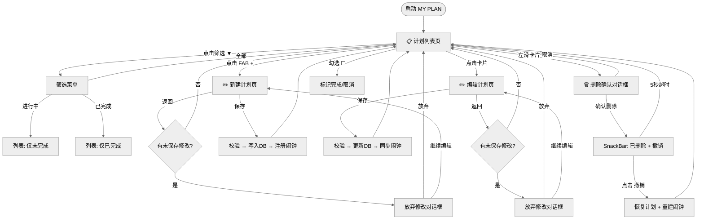
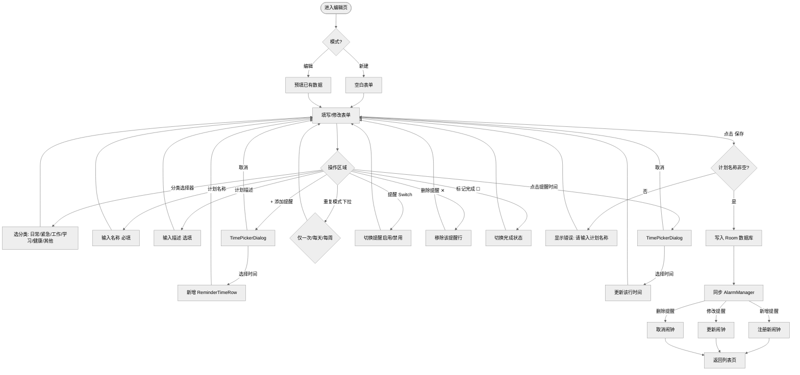
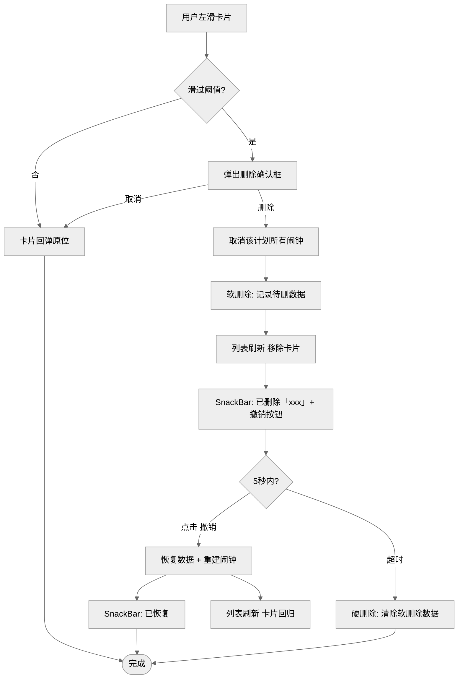
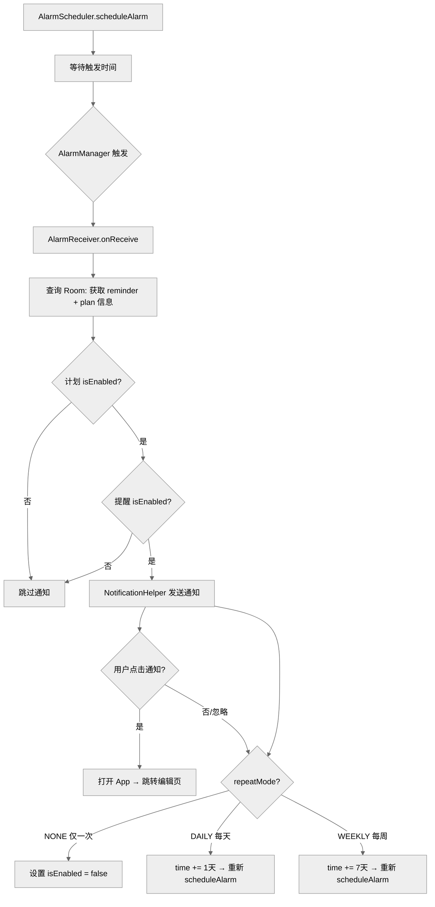
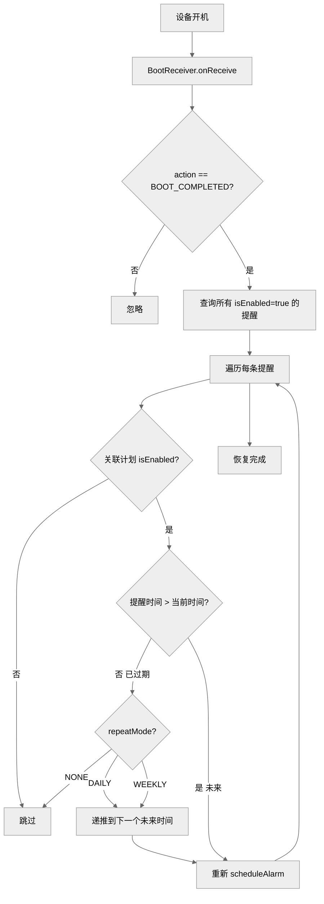
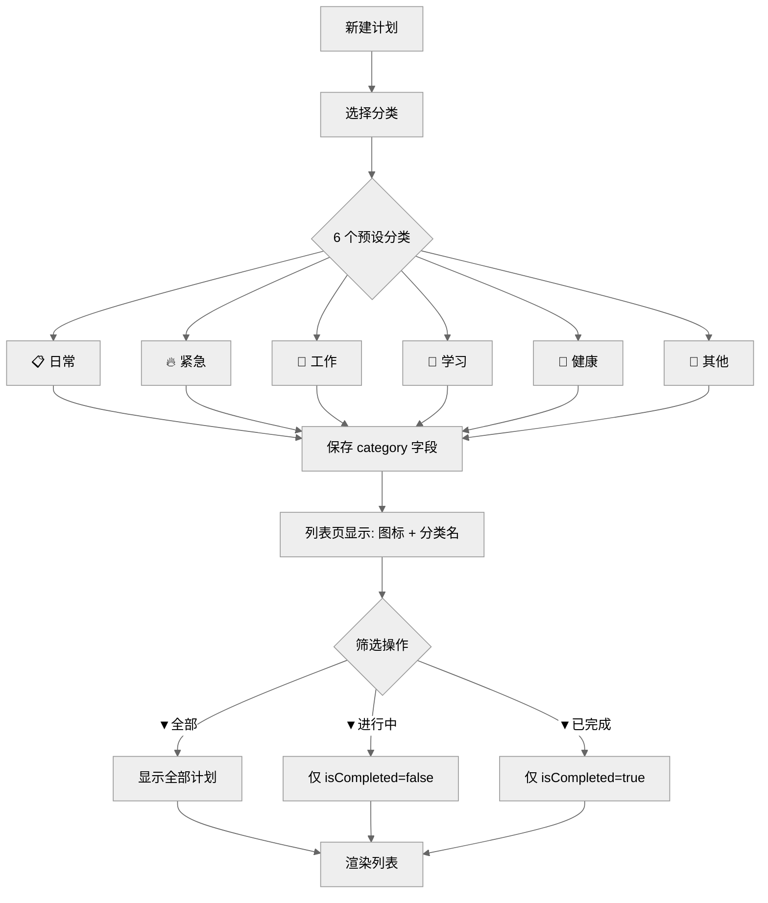

# MY PLAN — 流程图

> 在 VS Code 中按 `Ctrl+Shift+V` 预览，需要安装插件 **Markdown Preview Mermaid Support**

---

## 1. App 总导航流程

---

## 2. 新建/编辑计划流程

---

## 3. 删除与撤销流程

---

## 4. 提醒系统流程

---

## 5. 开机恢复流程

---

## 6. 分类与筛选流程

